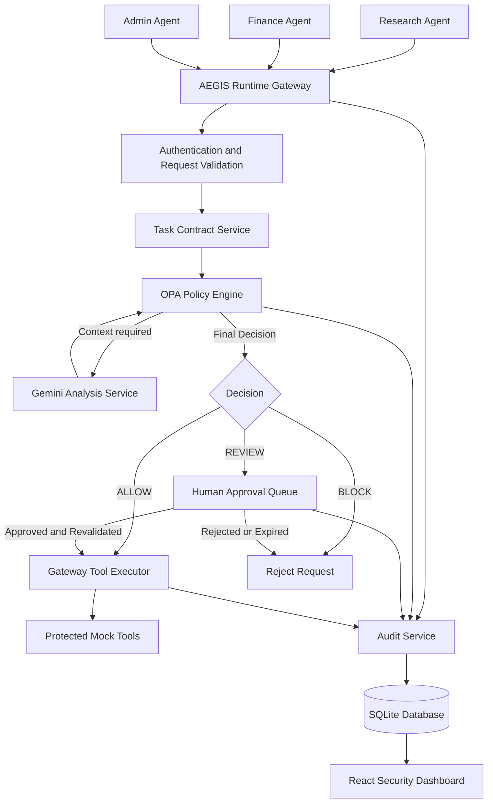

# AEGIS — SYSTEM ARCHITECTURE

**Project Name:** AEGIS  
**Full Name:** Task-Aware Runtime Security Gateway for Autonomous AI Agents  
**Document:** System Architecture  
**Version:** 1.0  
**Status:** Initial Architecture Specification  
**Development Stage:** Local MVP  
**Architecture Style:** Modular Application Architecture with Independent Policy Enforcement  
**Last Updated:** 14 November 2026

---

# 1. Document Purpose

This document defines how AEGIS will be structured and how its individual components will communicate.

It describes:

- Overall application architecture.
- Runtime request flow.
- Backend and frontend structure.
- Core system components.
- Technology stack.
- Task Contract structure.
- API design.
- Database design.
- Security boundaries.
- Error-handling approach.
- Local development and future deployment.

The architecture is the technical source of truth for implementation.

All source code must follow this architecture unless an approved architecture change is documented.

# 2. Architecture Overview

## 2.1 System Description

AEGIS uses a central application-layer security gateway between AI agents and protected tools.

Every protected tool request must pass through the gateway.

The gateway authenticates the requesting agent, retrieves its active Task Contract, validates the request and coordinates security evaluation.

OPA evaluates the security policies and returns a decision.

Gemini provides optional advisory contextual analysis when the request requires additional task-action understanding.

The gateway enforces the final decision and forwards only approved requests to the protected tool adapter.

## 2.2 High-Level Architecture



**Important:** The dashboard does not enforce security. All important security checks and tool execution controls happen on the backend.

# 3. Architecture Principles

## 3.1 Gateway-First Enforcement

Protected tools must receive requests only through the AEGIS Gateway.

Agents must not possess direct credentials for protected tools.

## 3.2 Least Privilege

Every agent receives only the tools, resources and operations required by its assigned task.

## 3.3 Independent Policy Decisions

OPA evaluates the security policies independently from the Gemini model.

## 3.4 Advisory AI Analysis

Gemini provides contextual analysis but cannot grant permissions or override hard security restrictions.

## 3.5 Fail-Closed Security

If a required security service cannot establish that an operation is permitted, the protected operation must not execute.

## 3.6 Separation of Responsibilities

Each component has a defined purpose and must not duplicate another component's core responsibilities.

## 3.7 Modular Development

Backend, policies, agent simulations, frontend, database and testing must remain logically separated.

## 3.8 Testable Architecture

Every major component must be testable independently and through integration tests.

# 4. Complete Runtime Request Flow

This section defines the required sequence for protected tool calls.

## Step 1 — Agent Request

An agent creates a structured tool request.

Example:

```json
{
  "tool": "test_database",
  "operation": "delete",
  "resource": "test_records",
  "parameters": {
    "record_id": "TEST-001"
  }
}
```

The agent sends the request to the AEGIS Gateway through an authenticated API request.

The agent ID supplied in an untrusted request body must not be treated as proof of identity.

## Step 2 — Gateway Authentication

The gateway authenticates the agent using its registered credential.

It identifies the authenticated agent from the verified credential, not merely from a supplied name.

Invalid, disabled or unknown identities are rejected.

## Step 3 — Request Validation

The gateway checks:

- Required fields.
- Supported tool names.
- Supported operations.
- Parameter formats.
- Request size limits.
- Request ID and idempotency requirements.

Unknown tools and malformed requests are rejected.

## Step 4 — Task Contract Retrieval

The gateway retrieves the authoritative active Task Contract from the backend database.

The contract must belong to the authenticated agent.

The gateway checks:

- Contract status.
- Contract expiry.
- Task assignment.
- Allowed tools.
- Allowed operations.
- Allowed resource scope.
- Contract version.

An agent cannot submit a different contract to replace its stored contract.

## Step 5 — Preliminary Security Checks

Clear restrictions are evaluated before unnecessary AI requests are made.

Examples:

- Invalid identity.
- Expired contract.
- Tool not allowed.
- Operation not allowed.
- Resource outside the permitted scope.
- Invalid tool parameters.

Clear violations can be rejected immediately.

Requests that pass hard checks but need contextual analysis continue through the evaluation pipeline.

## Step 6 — Gemini Contextual Analysis

Gemini is called only when additional contextual analysis is required.

It receives a minimum, sanitized set of relevant information:

- Assigned task description.
- Relevant task restrictions.
- Requested tool.
- Requested operation.
- Target resource.
- Necessary request context.

It returns an advisory structured assessment.

Gemini must not receive API keys, credentials or unnecessary sensitive data.

## Step 7 — Final OPA Evaluation

The gateway submits the verified identity, Task Contract, normalized request and validated advisory context, when available, to OPA.

OPA evaluates the configured Rego policies and produces the final policy decision:

- ALLOW.
- BLOCK.
- REVIEW.

Gemini's assessment is an input signal only. It cannot override explicit policy restrictions.

## Step 8 — Gateway Enforcement

The gateway receives the final decision.

**ALLOW:** The gateway executes the registered tool adapter.

**BLOCK:** The gateway rejects the request. No protected tool is called.

**REVIEW:** The gateway pauses execution and creates an approval request.

## Step 9 — Tool Execution

Only an approved request can reach the protected tool adapter.

The gateway uses server-held credentials or the mock tool interface.

The agent does not receive the tool's secret credentials.

The execution result is returned to the agent through the gateway.

## Step 10 — Audit Recording

The system records the security decision and execution outcome.

It stores enough information to understand and reproduce the event without exposing secrets.

# 5. Main System Components

## 5.1 Agent Simulation Service

**Location:** `agents/`

Responsibilities:

- Simulate Research, Finance and Admin agents.
- Generate structured tool requests.
- Send requests through the gateway.
- Demonstrate valid and invalid actions.
- Support repeatable demo scenarios.

The first version will use simple Python scenario clients.

A sophisticated autonomous-agent framework is not required for the MVP.

## 5.2 AEGIS API Gateway

**Location:** `backend/app/gateway/`

Main responsibilities:

- Accept authenticated requests.
- Generate request IDs.
- Authenticate agents.
- Validate and normalize requests.
- Retrieve task contracts.
- Coordinate security evaluation.
- Enforce final decisions.
- Execute approved tools.
- Return structured responses.

The gateway acts as the Policy Enforcement Point (PEP).

## 5.3 Authentication Service

**Location:** `backend/app/auth/`

Responsibilities:

- Register agent identities.
- Generate agent API credentials.
- Verify credentials.
- Disable or revoke credentials.
- Link authenticated identities to agent records.

For local development:

- Generate random high-entropy API tokens.
- Store a secure digest, not the original token.
- Show the token only when it is created.
- Use environment-based secrets for server configuration.

The agent must not be authenticated using an arbitrary `agent_id` supplied in a JSON body.

## 5.4 Task Contract Service

**Location:** `backend/app/contracts/`

Responsibilities:

- Create contracts.
- Retrieve active contracts.
- Update contracts through authorized administration.
- Track contract versions.
- Check expiry and status.
- Validate allowed tools, operations and resources.

Task Contracts must be controlled by the backend or authorized administrator.

## 5.5 Request Validation and Normalization

**Location:** `backend/app/validation/`

Responsibilities:

- Validate incoming request schemas.
- Reject unsupported operations.
- Validate parameters against tool definitions.
- Normalize tool and resource identifiers.
- Reject unknown or unexpected fields where appropriate.

No arbitrary SQL, shell commands, executable code or unrestricted tool names may be accepted.

## 5.6 Intent Verification Service

**Location:** `backend/app/security/`

Responsibilities:

- Compare task information with the requested action.
- Check task-action alignment.
- Identify obvious restrictions.
- Mark requests needing additional contextual analysis.
- Produce structured information for policy evaluation.

It must not independently execute tools or grant access.

## 5.7 Gemini Analysis Service

**Location:** `backend/app/ai/`

Responsibilities:

- Connect to the Gemini API.
- Prepare sanitized analysis inputs.
- Request structured output.
- Validate model responses.
- Handle timeouts and API errors.
- Return advisory context information.

It must not:

- Execute tool calls.
- Access protected databases directly.
- Change Task Contracts.
- Grant permissions.
- Override OPA restrictions.

The model ID must be configurable through environment variables.

Initial development setting:

```env
GEMINI_MODEL=gemini-3.8-flash
```

The model can be replaced without changing the overall gateway architecture.

## 5.8 OPA Policy Service

**Location:** `backend/app/policy/` and `opa/`

Responsibilities:

- Communicate with the local OPA service.
- Submit structured policy input.
- Retrieve policy decisions.
- Validate decision formats.
- Handle OPA errors.
- Reject protected execution when a valid decision is unavailable.

OPA acts as the Policy Decision Point (PDP).

Rego policies define permitted and restricted operations.

## 5.9 Decision and Enforcement Service

**Location:** `backend/app/decisions/`

Responsibilities:

- Coordinate the final decision.
- Interpret the OPA policy result.
- Enforce ALLOW, BLOCK and REVIEW.
- Prevent blocked requests from executing.
- Ensure REVIEW requests remain paused.
- Forward only approved requests to the tool executor.

The gateway is responsible for enforcement.

## 5.10 Protected Tool Registry and Execution

**Location:** `backend/app/tools/`

Responsibilities:

- Maintain a registry of approved tools.
- Map tool identifiers to specific adapters.
- Validate operation parameters.
- Execute approved operations.
- Record execution results.
- Prevent unknown tools from executing.

Initial mock tools:

- Public Search.
- Public Document Reader.
- Finance Mock Database.
- Admin Mock Tools.

Only explicitly registered adapters may execute.

## 5.11 Human Approval Service

**Location:** `backend/app/approvals/`

Responsibilities:

- Create approval requests.
- Display pending reviews.
- Authenticate reviewers.
- Record approval or rejection.
- Bind approval to the exact request.
- Enforce approval expiry.
- Revalidate security conditions before execution.

An approval must not act as a permanent permission grant.

## 5.12 Audit Service

**Location:** `backend/app/audit/`

Responsibilities:

- Record security decisions.
- Record execution outcomes.
- Record approval events.
- Store request identifiers.
- Provide audit history.
- Prevent unauthorized modifications through application access controls.

The MVP will use controlled append-only application behaviour.

Do not describe ordinary database logs as cryptographically tamper-proof. Strong integrity protection is a future enhancement.

## 5.13 Dashboard API and Frontend

**Backend Location:** `backend/app/api/`

**Frontend Location:** `frontend/`

The backend exposes dashboard information through authenticated APIs.

The frontend displays:

- Dashboard overview.
- Registered agents.
- Task Contracts.
- Request activity.
- Security decisions.
- Pending approvals.
- Audit events.
- Request details.

No final permission decision may rely on frontend-only checks.

# 6. Core Security Decision Flow

The following decision logic is required.

| Situation | Required outcome |
|---|---|
| Unknown agent | BLOCK |
| Invalid credentials | BLOCK |
| Disabled agent | BLOCK |
| Missing contract | BLOCK |
| Expired contract | BLOCK |
| Tool not allowed | BLOCK |
| Operation not allowed | BLOCK |
| Resource outside allowed scope | BLOCK |
| Invalid tool parameters | BLOCK |
| Ambiguous request requiring approval | REVIEW |
| Sensitive operation requiring approval | REVIEW |
| Valid request passing every required check | ALLOW |
| OPA unavailable | Do not execute |
| Invalid Gemini output for a context-required request | REVIEW or BLOCK |
| Gemini unavailable for a context-required request | REVIEW or BLOCK |

A REVIEW request must not execute until the reviewer has approved the exact request and the gateway has revalidated its security conditions.

# 7. Task Contract Data Structure

A Task Contract is the authoritative record of an agent's current work scope.

Illustrative JSON:

```json
{
  "contract_id": "TC-001",
  "agent_id": "admin_01",
  "contract_version": 1,
  "task_description": "Read-only audit of test records",
  "allowed_tools": [
    "test_database"
  ],
  "allowed_operations": [
    "read"
  ],
  "allowed_resources": [
    "test_records"
  ],
  "restricted_operations": [
    "delete",
    "bulk_export"
  ],
  "status": "active",
  "expires_at": "2026-11-14T18:00:00Z"
}
```

This is an example schema.

The authoritative contract must be loaded from the backend database.

Agents cannot create or change their own contract version.

# 8. Tool Request Data Structure

Illustrative request:

```json
{
  "tool": "test_database",
  "operation": "delete",
  "resource": "test_records",
  "parameters": {
    "record_id": "TEST-001"
  }
}
```

The authenticated agent identity must be derived from the credential.

The request body must not be trusted to establish the agent's identity.

# 9. Gemini Advisory Output Structure

Illustrative response:

```json
{
  "task_alignment": "MISMATCH",
  "risk_signals": [
    "Requested action is outside the assigned task"
  ],
  "reason": "The task is read-only, but the request attempts deletion"
}
```

Allowed alignment values:

- MATCH.
- MISMATCH.
- UNCLEAR.

The backend must validate the response schema and accepted values.

The model explanation is advisory data, not a security permission.

The policy engine must retain control over the final decision.

# 10. OPA Decision Structure

Illustrative final response:

```json
{
  "decision": "BLOCK",
  "reason_code": "OPERATION_NOT_PERMITTED",
  "reason": "Delete is not allowed by the active Task Contract",
  "policy_version": "1"
}
```

Supported final decisions:

- ALLOW.
- BLOCK.
- REVIEW.

The gateway must reject missing, malformed or unexpected decision responses.

# 11. Human Approval Architecture

A pending request must have:

- Approval ID.
- Original request ID.
- Agent identity.
- Task Contract ID and version.
- Requested operation.
- Target resource.
- Request fingerprint or equivalent integrity binding.
- Review reason.
- Request expiry.
- Reviewer identity.
- Approval or rejection status.

The approval must be bound to the exact request content.

After approval:

1. Recheck the reviewer authorization.
2. Verify that the approval has not expired.
3. Confirm that the original request has not changed.
4. Verify that the Task Contract is still valid.
5. Re-evaluate relevant OPA policies.
6. Execute only if all requirements still pass.

# 12. Database Architecture

## 12.1 Initial Database

**SQLite**

SQLite will be used for local MVP development.

It avoids the need for a paid database service.

## 12.2 Future Database

**PostgreSQL**

PostgreSQL can be introduced for hosted deployment and concurrent usage.

Database access must be handled through the backend.

## 12.3 Main Database Entities

| Entity | Purpose |
|---|---|
| agents | Stores agent information |
| agent_credentials | Stores secure credential digests and status |
| task_contracts | Stores task assignments and permissions |
| tools | Stores registered tool definitions |
| tool_requests | Stores incoming request records |
| security_decisions | Stores policy decisions and reasons |
| approval_requests | Stores human review information |
| audit_events | Stores security and execution history |
| administrators | Stores authorized dashboard users |

## 12.4 Database Design Rules

- Use unique IDs.
- Define appropriate foreign keys.
- Validate relationships.
- Use database migrations.
- Avoid duplicate records.
- Do not store plain API keys.
- Do not store unnecessary secrets.
- Preserve request and approval history.
- Restrict audit modification through application permissions.

Use SQLAlchemy for data access and Alembic for schema migrations.

# 13. API Architecture

The following endpoints are proposed for the MVP.

## Agent APIs

```text
GET    /api/v1/agents
POST   /api/v1/agents
GET    /api/v1/agents/{agent_id}
PATCH  /api/v1/agents/{agent_id}
```

## Task Contract APIs

```text
GET    /api/v1/contracts
POST   /api/v1/contracts
GET    /api/v1/contracts/{contract_id}
PATCH  /api/v1/contracts/{contract_id}
```

## Gateway APIs

```text
POST   /api/v1/tool-requests
GET    /api/v1/tool-requests/{request_id}
GET    /api/v1/tool-requests
```

## Approval APIs

```text
GET    /api/v1/approvals
GET    /api/v1/approvals/{approval_id}
POST   /api/v1/approvals/{approval_id}/approve
POST   /api/v1/approvals/{approval_id}/reject
```

## Audit APIs

```text
GET    /api/v1/audit-events
GET    /api/v1/audit-events/{event_id}
```

## Dashboard APIs

```text
GET    /api/v1/dashboard/overview
GET    /api/v1/dashboard/activity
```

These routes are initial design choices. The backend implementation must document actual request schemas, response schemas, authentication requirements and error codes.

# 14. Technology Stack

## 14.1 Backend

| Technology | Purpose |
|---|---|
| Python 3.12+ | Main backend language |
| FastAPI | REST API and gateway |
| Pydantic | Request and response validation |
| SQLAlchemy 2 | Database access |
| Alembic | Database migrations |
| HTTPX | HTTP communication with OPA and external services |
| google-genai | Gemini API integration |
| Pytest | Automated backend tests |
| Ruff | Python formatting and linting |

Use compatible stable versions and maintain them through dependency lock files.

## 14.2 Frontend

| Technology | Purpose |
|---|---|
| TypeScript | Frontend programming language |
| React | UI framework |
| Vite | Frontend development and build tooling |
| Tailwind CSS | Styling system |
| React Router | Application navigation |
| Zod | Client-side data validation |

The frontend is a monitoring and administration interface. It does not enforce runtime tool permissions.

## 14.3 Policy Engine

| Technology | Purpose |
|---|---|
| Open Policy Agent | Policy evaluation |
| Rego | Security policy language |
| OPA REST API | Backend communication |

OPA should run locally during development and should not be exposed as an unauthenticated public service.

## 14.4 Database

| Technology | Purpose |
|---|---|
| SQLite | Local MVP |
| PostgreSQL | Future hosted deployment |
| SQLAlchemy | Data access |
| Alembic | Schema migration |

## 14.5 Agent Simulation

Use Python scripts to simulate the three agents.

A framework such as LangGraph is not required for the initial MVP.

## 14.6 Development Tools

| Tool | Purpose |
|---|---|
| VS Code | Code editor |
| Git | Version control |
| GitHub | Source code repository |
| Google Antigravity | AI-assisted development |
| Google AI Studio | Gemini prototyping |
| Docker Compose | Optional local service orchestration |

# 15. Recommended Folder and File Structure

The following is the target architecture for the initial AEGIS repository.

```text
AEGIS/
│
├── AGENTS.md
├── README.md
├── .env.example
├── .gitignore
├── docker-compose.yml
│
├── PRD.md
├── ARCHITECTURE.md
├── AGENT_RULES.md
├── DEVELOPMENT_PHASES.md
├── DESIGN_SYSTEM.md
├── UI_UX.md
├── BACKEND.md
│
├── docs/
│   ├── PROJECT_OVERVIEW.md
│   ├── SECURITY_MODEL.md
│   ├── TASK_CONTRACT_SPEC.md
│   ├── API_SPECIFICATION.md
│   ├── OPA_POLICY_DESIGN.md
│   ├── DATABASE_DESIGN.md
│   ├── GEMINI_INTEGRATION.md
│   └── TESTING_STRATEGY.md
│
├── backend/
│   ├── pyproject.toml
│   │
│   ├── app/
│   │   ├── main.py
│   │   │
│   │   ├── api/
│   │   │   ├── router.py
│   │   │   ├── agents.py
│   │   │   ├── contracts.py
│   │   │   ├── tool_requests.py
│   │   │   ├── approvals.py
│   │   │   ├── audit.py
│   │   │   └── dashboard.py
│   │   │
│   │   ├── core/
│   │   │   ├── config.py
│   │   │   ├── dependencies.py
│   │   │   ├── exceptions.py
│   │   │   └── logging.py
│   │   │
│   │   ├── auth/
│   │   │   ├── authentication.py
│   │   │   ├── credentials.py
│   │   │   └── authorization.py
│   │   │
│   │   ├── gateway/
│   │   │   ├── gateway_service.py
│   │   │   ├── request_validator.py
│   │   │   └── request_normalizer.py
│   │   │
│   │   ├── contracts/
│   │   │   ├── contract_service.py
│   │   │   └── contract_repository.py
│   │   │
│   │   ├── security/
│   │   │   ├── intent_verifier.py
│   │   │   └── decision_service.py
│   │   │
│   │   ├── ai/
│   │   │   ├── gemini_client.py
│   │   │   ├── gemini_analyzer.py
│   │   │   └── output_validator.py
│   │   │
│   │   ├── policy/
│   │   │   ├── opa_client.py
│   │   │   └── policy_service.py
│   │   │
│   │   ├── tools/
│   │   │   ├── registry.py
│   │   │   ├── executor.py
│   │   │   └── adapters/
│   │   │       ├── public_search.py
│   │   │       ├── finance_mock.py
│   │   │       └── admin_mock.py
│   │   │
│   │   ├── approvals/
│   │   │   └── approval_service.py
│   │   │
│   │   ├── audit/
│   │   │   └── audit_service.py
│   │   │
│   │   ├── dashboard/
│   │   │   └── dashboard_service.py
│   │   │
│   │   ├── database/
│   │   │   ├── base.py
│   │   │   ├── session.py
│   │   │   ├── models/
│   │   │   └── repositories/
│   │   │
│   │   └── schemas/
│   │       ├── agent.py
│   │       ├── contract.py
│   │       ├── tool_request.py
│   │       ├── decision.py
│   │       └── approval.py
│   │
│   └── tests/
│       ├── unit/
│       ├── integration/
│       └── security/
│
├── opa/
│   ├── policies/
│   │   ├── agent_access.rego
│   │   ├── task_scope.rego
│   │   └── operation_rules.rego
│   │
│   └── tests/
│
├── agents/
│   ├── research_agent.py
│   ├── finance_agent.py
│   ├── admin_agent.py
│   └── scenario_runner.py
│
├── frontend/
│   ├── package.json
│   ├── vite.config.ts
│   ├── tsconfig.json
│   │
│   └── src/
│       ├── main.tsx
│       ├── App.tsx
│       │
│       ├── app/
│       │   ├── router.tsx
│       │   └── providers.tsx
│       │
│       ├── components/
│       ├── features/
│       │   ├── agents/
│       │   ├── contracts/
│       │   ├── requests/
│       │   ├── approvals/
│       │   ├── audit/
│       │   └── dashboard/
│       │
│       ├── services/
│       │   └── api.ts
│       │
│       ├── hooks/
│       ├── layouts/
│       ├── styles/
│       └── types/
│
├── scripts/
│   ├── start_dev.py
│   ├── seed_demo_data.py
│   └── run_scenarios.py
│
└── tests/
    ├── end_to_end/
    └── fixtures/
```

This is the target structure, not a requirement to generate every file immediately.

Create files when their implementation phase begins. Avoid empty files created only to match the diagram.

# 16. Environment Configuration

All environment-specific settings must be configurable.

Illustrative `.env.example`:

```env
APP_ENV=development
APP_HOST=127.0.0.1
APP_PORT=8000

DATABASE_URL=sqlite:///./aegis.db

OPA_URL=http://127.0.0.1:8181

GEMINI_API_KEY=
GEMINI_MODEL=gemini-3.8-flash

LOG_LEVEL=INFO

ADMIN_SECRET=
```

Rules:

- `.env.example` contains placeholders only.
- Real `.env` files must be excluded from Git.
- API keys must never appear in source code.
- Do not expose secret configuration to the frontend.
- Production secrets must use a secure deployment secret manager.

# 17. Error Handling Architecture

Every component must handle failures clearly.

| Component | Failure | Required behaviour |
|---|---|---|
| Authentication | Invalid credential | Reject request |
| Task Contract | Missing or expired contract | Block |
| Validation | Invalid request | Reject without tool execution |
| OPA | Timeout or unavailable | Do not execute |
| Gemini | Timeout or invalid response | REVIEW or BLOCK when context is required |
| Database | Unavailable | Do not authorize using stale or missing information |
| Tool Adapter | Execution failure | Record execution failure |
| Approval | Expired or invalid approval | Do not execute |
| Frontend | API failure | Show safe error message |

Never return stack traces, credentials or internal secrets to users or agents.

# 18. Audit and Observability

The system should record:

- Incoming request.
- Authenticated agent.
- Contract version.
- Preliminary validation outcome.
- OPA decision.
- Gemini analysis status, when used.
- Human approval result.
- Tool execution result.
- Processing duration.
- Error information.

Use structured logs with request IDs so one tool call can be followed across multiple backend components.

The initial database audit history is application-level logging, not a cryptographic tamper-proof audit system.

# 19. Testing Architecture

Testing must be developed alongside the application.

## Unit Tests

Test individual components:

- Authentication.
- Task Contract validation.
- Request validation.
- Intent verification.
- Gemini response validation.
- Policy response parsing.
- Tool registry.
- Approval expiry.

## Policy Tests

Test Rego policies with:

- Allowed tools.
- Forbidden tools.
- Allowed operations.
- Forbidden operations.
- Expired contracts.
- Invalid resource scope.
- Human approval requirements.

## Integration Tests

Test connections between:

- FastAPI and SQLite.
- FastAPI and OPA.
- FastAPI and Gemini.
- Gateway and tool adapters.
- Approval service and gateway.
- Audit service and database.

## End-to-End Tests

Test complete scenarios:

1. Valid public search is allowed.
2. Research Agent attempts finance access and is blocked.
3. Admin Agent requests deletion during a read-only task and is blocked.
4. Finance export requires approval.
5. Approved request is revalidated before execution.
6. Invalid credentials are rejected.
7. Gemini failure does not bypass security.
8. Direct access to a protected tool is rejected.

# 20. Local Development Architecture

The first deployment target is the developer's local computer.

Required local services:

- FastAPI backend.
- React development server.
- Local OPA service.
- SQLite database.
- Python simulated agents.
- Gemini API connection when configured.

The initial MVP must continue to support deterministic security checks when Gemini is unavailable, provided no contextual model assessment is required for the specific decision.

Do not purchase hosting, domains or database services for the initial development stage.

# 21. Future Deployment Architecture

A future hosted version may use:

- FastAPI deployed as a backend service.
- PostgreSQL as the main database.
- A privately accessible OPA service.
- Gemini API through server-side credentials.
- React frontend hosting.
- Centralized logging and monitoring.
- Secure backups.
- Production authentication.
- Rate limits and request protection.

The OPA service and protected tools must not be publicly accessible without suitable access controls.

Production deployment requires a separate security review.

# 22. Architecture Change Rules

Any architecture change must:

1. Explain why the change is necessary.
2. Identify affected components.
3. Identify affected API contracts.
4. Identify security implications.
5. Update relevant documentation.
6. Add or update tests.
7. Avoid unnecessary technology changes.

An AI coding agent must not silently replace the approved stack or restructure the project without explaining the reason and obtaining approval.

# 23. Official Technical References

- Open Policy Agent — Agent Tool Calling: https://www.openpolicyagent.org/docs/agent-tool-calling
- Open Policy Agent — Deployment: https://www.openpolicyagent.org/docs/deploy
- Gemini API — Models: https://ai.google.dev/gemini-api/docs/models
- Gemini API — Structured Outputs: https://ai.google.dev/gemini-api/docs/structured-output
- FastAPI: https://fastapi.tiangolo.com/
- SQLAlchemy: https://docs.sqlalchemy.org/
- React: https://react.dev/
- Vite: https://vite.dev/
- Pytest: https://docs.pytest.org/

---

**END OF ARCHITECTURE.md**