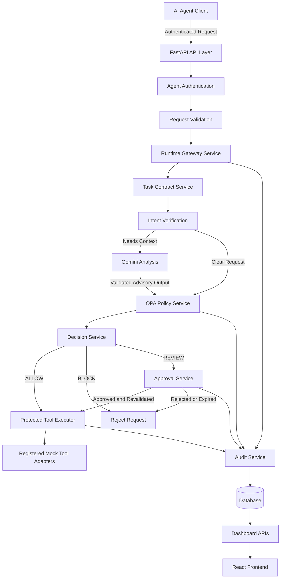

# AEGIS — BACKEND DEVELOPMENT SPECIFICATION

**Project:** AEGIS  
**Full Name:** Task-Aware Runtime Security Gateway for Autonomous AI Agents  
**Document:** Backend Development Specification  
**Version:** 1.0  
**Status:** Initial Backend Specification  
**Backend Language:** Python  
**Backend Framework:** FastAPI  
**Architecture:** Modular, Service-Based Backend  
**Database:** SQLite initially, PostgreSQL later  
**Policy Engine:** Open Policy Agent (OPA)  
**AI Integration:** Gemini API  
**Last Updated:** 14 November 2026

---

# 1. PURPOSE

This document defines the backend architecture, implementation standards, services, APIs, database structure, security processing and integrations required to build AEGIS.

It acts as the main backend development reference for AI coding agents and human developers.

The backend is the most important part of AEGIS because it controls:

- Agent authentication.
- Task Contract management.
- Protected tool requests.
- Identity verification.
- Request validation.
- Task-action verification.
- Gemini contextual analysis.
- OPA policy evaluation.
- ALLOW, BLOCK and REVIEW decisions.
- Protected tool execution.
- Human approval.
- Audit records.
- Dashboard data.

The frontend must never replace or bypass backend security decisions.

# 2. BACKEND OBJECTIVES

The backend must:

1. Provide secure APIs for the AEGIS application.
2. Authenticate AI agents and human users separately.
3. Maintain authoritative agent identities.
4. Store and validate Task Contracts.
5. Receive all protected tool requests.
6. Validate and normalize incoming requests.
7. Check task, operation and resource restrictions.
8. Integrate Gemini for advisory contextual analysis.
9. Integrate OPA for final policy decisions.
10. Enforce ALLOW, BLOCK and REVIEW outcomes.
11. Execute tools only through approved adapters.
12. Provide request-specific human approval.
13. Record complete security events.
14. Supply accurate data to the React dashboard.
15. Handle failures without silently permitting protected actions.

# 3. APPROVED TECHNOLOGY STACK

## 3.1 Main Backend Technologies

| Technology | Version / Requirement | Responsibility |
|---|---|---|
| Python | 3.12+ | Main programming language |
| FastAPI | Compatible stable version | Backend API framework |
| Pydantic | Compatible stable version | Request and response validation |
| SQLAlchemy | Version 2.x | Database access |
| Alembic | Compatible stable version | Database migrations |
| HTTPX | Compatible stable version | External HTTP communication |
| google-genai | Compatible stable version | Gemini API integration |
| Pytest | Compatible stable version | Automated testing |
| Ruff | Compatible stable version | Linting and formatting |
| SQLite | Initial MVP | Local database |
| PostgreSQL | Future version | Hosted database |

Exact compatible dependency versions must be selected and locked when implementation begins.

Do not blindly install the latest versions without checking compatibility.

## 3.2 Backend Policy Engine

**Open Policy Agent (OPA)**

Policy language: **Rego**

Responsibilities:

- Evaluate agent permissions.
- Evaluate Task Contract restrictions.
- Evaluate resource access.
- Evaluate operation restrictions.
- Enforce hard security boundaries.
- Produce ALLOW, BLOCK or REVIEW policy decisions.

OPA must remain independent from Gemini.

## 3.3 AI Integration

**Model:** Gemini 3.8 Flash  
**Integration:** Gemini API  
**Purpose:** Context-aware task-action analysis.

The model ID must come from backend configuration.

The backend must support changing the model without changing the gateway architecture.

## 3.4 Development and Local Services

- Git and GitHub.
- VS Code.
- Google Antigravity.
- Google AI Studio.
- Local OPA service.
- Local SQLite database.
- Docker Compose when useful.

The initial application must support local development without paid hosting.

# 4. BACKEND ARCHITECTURE

The backend follows a modular architecture.

Each module has one clear responsibility.



# 5. BACKEND MODULE STRUCTURE

The backend must be organized according to its responsibilities.

## 5.1 API Layer

**Location:** `backend/app/api/`

Purpose:

- Define HTTP routes.
- Receive API requests.
- Apply authentication dependencies.
- Validate inputs.
- Call service-layer functions.
- Return structured API responses.

API routes must not contain complex security decision logic.

## 5.2 Core Module

**Location:** `backend/app/core/`

Responsibilities:

- Application configuration.
- Dependency creation.
- Exception definitions.
- Logging configuration.
- Shared application settings.
- Startup and shutdown configuration.

## 5.3 Authentication Module

**Location:** `backend/app/auth/`

Responsibilities:

- Agent API credential creation.
- Credential verification.
- Credential revocation.
- Human-user authentication.
- Role-based authorization.
- Session management.

Agent and human-user authentication must be separated.

## 5.4 Gateway Module

**Location:** `backend/app/gateway/`

Responsibilities:

- Receive normalized requests.
- Generate request IDs.
- Coordinate request processing.
- Retrieve Task Contracts.
- Call security services.
- Enforce final decisions.
- Forward approved requests.
- Return results.

The gateway is the Policy Enforcement Point.

## 5.5 Task Contract Module

**Location:** `backend/app/contracts/`

Responsibilities:

- Contract creation.
- Contract retrieval.
- Contract updates.
- Contract versioning.
- Contract expiry.
- Allowed tool validation.
- Allowed resource validation.
- Allowed operation validation.

The backend remains the authoritative source of Task Contracts.

## 5.6 Validation Module

**Location:** `backend/app/validation/`

Responsibilities:

- Pydantic request schema validation.
- Tool identifier validation.
- Operation validation.
- Resource identifier validation.
- Parameter validation.
- Request normalization.
- Request size validation.

Unknown tool names and unsupported operations must be rejected.

## 5.7 Security Module

**Location:** `backend/app/security/`

Responsibilities:

- Deterministic restriction checks.
- Intent-to-Action verification.
- Task-scope evaluation.
- Security decision coordination.
- Hard-deny handling.
- Default-deny behaviour.

This module must not execute protected tools directly.

## 5.8 AI Module

**Location:** `backend/app/ai/`

Responsibilities:

- Gemini API client.
- Context preparation.
- Prompt management.
- Model invocation.
- Structured output validation.
- Timeout handling.
- Retry handling where safe.
- API error handling.
- Model response monitoring.

Gemini is an advisory analysis service only.

## 5.9 Policy Module

**Location:** `backend/app/policy/`

Responsibilities:

- OPA communication.
- Policy input construction.
- Policy result validation.
- Policy error handling.
- Final decision retrieval.

The backend must not treat an unavailable policy service as an approval.

## 5.10 Tool Module

**Location:** `backend/app/tools/`

Responsibilities:

- Server-side tool registry.
- Tool schema definitions.
- Parameter validation.
- Approved tool adapters.
- Tool execution.
- Execution result handling.

Only explicitly registered adapters may execute.

Never dynamically execute arbitrary tool names, SQL or shell commands received from an agent.

## 5.11 Approval Module

**Location:** `backend/app/approvals/`

Responsibilities:

- Approval creation.
- Approval retrieval.
- Reviewer authorization.
- Approval expiry.
- Approval decisions.
- Request binding.
- Post-approval revalidation.

## 5.12 Audit Module

**Location:** `backend/app/audit/`

Responsibilities:

- Security event creation.
- Request history.
- Decision history.
- Approval history.
- Execution history.
- Audit retrieval.
- Data masking.

## 5.13 Database Module

**Location:** `backend/app/database/`

Responsibilities:

- SQLAlchemy configuration.
- Database sessions.
- Model definitions.
- Repository operations.
- Database migration integration.

Service-layer code should not duplicate database query logic.

# 6. BACKEND REQUEST PROCESSING

The following sequence is mandatory for protected tool requests.

## Step 1 — Receive Request

The FastAPI gateway endpoint receives a structured request from an agent.

Required request information:

- Tool.
- Operation.
- Resource.
- Parameters.

The authenticated agent identity is obtained from the credential, not trusted from a JSON field.

## Step 2 — Authenticate

Verify the agent's credential.

Reject:

- Unknown credentials.
- Revoked credentials.
- Disabled agents.
- Invalid authentication.

## Step 3 — Validate Request

Check the request schema and supported values.

Reject:

- Missing required fields.
- Unknown tools.
- Unsupported operations.
- Invalid parameters.
- Unexpected or malformed data.

## Step 4 — Generate Request ID

Generate a unique server-side request ID.

Connect every subsequent decision, approval, tool result and audit event to that ID.

## Step 5 — Load Task Contract

Retrieve the active contract associated with the authenticated agent.

Verify:

- Agent ownership.
- Contract status.
- Contract expiry.
- Contract version.
- Allowed tools.
- Allowed operations.
- Allowed resources.

## Step 6 — Apply Deterministic Restrictions

Check clear security restrictions before making unnecessary external AI calls.

Examples:

- Missing contract.
- Expired contract.
- Tool outside the permitted list.
- Forbidden operation.
- Out-of-scope resource.
- Invalid parameter values.

Reject clear violations immediately.

## Step 7 — Perform Contextual Analysis When Needed

If the request requires semantic task-action analysis, call Gemini.

The request context must be limited to the minimum required information.

The backend must validate the model response.

## Step 8 — Submit Final Policy Input to OPA

OPA evaluates:

- Authenticated identity.
- Task Contract.
- Requested tool.
- Operation.
- Resource.
- Deterministic verification results.
- Validated Gemini advisory signals, when available.
- Approval requirements.

OPA produces the final policy result.

## Step 9 — Enforce Decision

**ALLOW:** Forward the request to the approved tool adapter.

**BLOCK:** Reject it without calling the protected tool.

**REVIEW:** Create a pending approval request and pause execution.

## Step 10 — Record Results

Store:

- Request information.
- Policy decision.
- Decision reason.
- Tool execution result.
- Approval details.
- Processing time.
- Related audit events.

# 7. AUTHENTICATION AND AUTHORIZATION

## 7.1 Agent Authentication

Agents will use individual, randomly generated credentials.

Requirements:

- Generate high-entropy credentials.
- Store credential digests, not original tokens.
- Revoke credentials when required.
- Associate each credential with one registered agent.
- Support disabled agents.
- Avoid logging credentials.
- Never send credentials to Gemini.

Use a cryptographic hash suitable for high-entropy token verification, with constant-time comparison where appropriate.

## 7.2 Human Authentication

The dashboard must authenticate human users separately.

For the initial version:

- Store password hashes using a maintained Argon2id implementation.
- Use server-managed sessions.
- Protect authenticated endpoints.
- Implement role-based authorization.
- Support session expiry and logout.

Use secure, HTTP-only and appropriate SameSite cookies in production.

Do not store human passwords or long-lived session secrets in local browser storage.

## 7.3 Authorization Roles

Initial roles:

| Role | Permissions |
|---|---|
| Administrator | Manage agents, contracts, users and configuration |
| Security Operator | Monitor requests and security activity |
| Reviewer | Approve or reject eligible requests |
| Auditor | Read audit records |

Authorization must be checked by the backend on every protected operation.

Hiding a button in React is not authorization.

# 8. TASK CONTRACT BACKEND

The contract service is responsible for maintaining trusted task scope.

## Required Fields

- Contract ID.
- Agent ID.
- Version.
- Task description.
- Allowed tools.
- Allowed operations.
- Allowed resources.
- Restrictions.
- Approval requirements.
- Status.
- Expiry.
- Creator.
- Creation timestamp.
- Update timestamp.

## Contract Rules

1. Each contract must belong to a registered agent.
2. Agents cannot modify their own contracts.
3. Only authorized administrators can create or update contracts.
4. Contract ownership must be checked.
5. Expired contracts cannot authorize requests.
6. Contract versions must be preserved.
7. Pending approvals must be revalidated when the active contract changes.

# 9. INTENT-TO-ACTION VERIFICATION

This is AEGIS's core security service.

It evaluates whether the requested operation fits the agent's assigned task and restrictions.

## Four Main Dimensions

**Agent Identity**

Who is requesting the action?

**Assigned Task**

What task is the agent currently expected to perform?

**Requested Operation**

What is the agent trying to do?

**Target Resource**

Which tool or resource is being accessed?

## Verification Methods

### Deterministic Checks

Use structured data and explicit restrictions.

Examples:

- Tool is not permitted.
- Operation is not permitted.
- Resource is not in scope.
- Contract is expired.
- Agent is disabled.

### Contextual Analysis

Use Gemini when understanding the relationship between the task and the requested action needs additional language analysis.

Possible alignment values:

- MATCH.
- MISMATCH.
- UNCLEAR.

These values are advisory analysis results, not access permissions.

# 10. GEMINI BACKEND INTEGRATION

## 10.1 Responsibilities

The Gemini service must:

- Connect through the official Google Gen AI SDK.
- Use the configured API key.
- Use the configured model ID.
- Prepare a controlled analysis prompt.
- Submit minimum necessary context.
- Request structured output.
- Validate the response.
- Handle API errors and limits.

## 10.2 Configuration

Illustrative environment settings:

```env
GEMINI_API_KEY=
GEMINI_MODEL=gemini-3.8-flash
GEMINI_TIMEOUT_SECONDS=5
GEMINI_MAX_RETRIES=1
```

The timeout and retry values are initial configuration proposals and must be tuned after testing.

## 10.3 Advisory Output

Expected fields:

- `task_alignment`
- `risk_signals`
- `reason`

Example:

```json
{
  "task_alignment": "MISMATCH",
  "risk_signals": [
    "Operation appears outside assigned task scope"
  ],
  "reason": "The assigned task is read-only but the request attempts deletion."
}
```

The backend must validate:

- Field presence.
- Field types.
- Allowed alignment values.
- Maximum string lengths.
- Expected list structure.

Do not directly trust a model explanation.

## 10.4 Gemini Failure Behaviour

Handle:

- Timeout.
- Rate limit.
- Authentication error.
- Invalid response.
- Malformed JSON.
- Service unavailable.
- Unexpected response type.

If Gemini is needed for contextual analysis and fails, uncertain sensitive requests must be REVIEW or BLOCK.

Hard restrictions must remain enforced without Gemini.

# 11. OPEN POLICY AGENT INTEGRATION

## 11.1 Responsibilities

OPA evaluates security rules using Rego policies.

The backend communicates with OPA through its local API.

## 11.2 Suggested Policy Packages

```text
opa/
├── policies/
│   ├── agent_access.rego
│   ├── task_scope.rego
│   └── operation_rules.rego
│
└── tests/
```

The exact package and rule names must be consistent between Rego files, tests and the backend OPA client.

## 11.3 Policy Input

OPA should receive normalized and trusted information.

Example:

```json
{
  "agent": {
    "id": "admin_01",
    "status": "active"
  },
  "contract": {
    "status": "active",
    "allowed_tools": ["test_database"],
    "allowed_operations": ["read"],
    "allowed_resources": ["test_records"]
  },
  "request": {
    "tool": "test_database",
    "operation": "delete",
    "resource": "test_records"
  }
}
```

This is an illustrative policy input.

## 11.4 Final Decision

OPA must produce a defined result.

Example:

```json
{
  "decision": "BLOCK",
  "reason_code": "OPERATION_NOT_PERMITTED",
  "reason": "Delete is not permitted by the active Task Contract."
}
```

The gateway must validate the decision response before enforcing it.

## 11.5 OPA Failure

If OPA is unavailable, times out or returns an invalid response:

- Do not execute protected tools.
- Return a safe error.
- Record the failure where possible.
- Do not convert the error into ALLOW.

# 12. DECISION AND TOOL EXECUTION

The gateway must enforce the final OPA decision.

## ALLOW

1. Validate the final decision.
2. Verify tool registration.
3. Validate tool parameters.
4. Execute the approved adapter.
5. Record result.
6. Return a safe response.

## BLOCK

1. Stop processing.
2. Do not call the tool adapter.
3. Record the denial.
4. Return a structured rejection.

## REVIEW

1. Create approval request.
2. Bind it to the exact original request.
3. Set expiry.
4. Keep the request paused.
5. Wait for authorized human action.

After approval, the system must verify the contract, approval, identity, expiry and policy conditions again.

# 13. PROTECTED TOOL REGISTRY

The tool registry must be controlled by backend code or trusted server configuration.

Every tool must define:

- Unique tool ID.
- Description.
- Supported operations.
- Parameter schema.
- Resource restrictions.
- Execution adapter.

The initial MVP must use mock adapters.

Examples:

- Public Search Adapter.
- Public Document Reader Adapter.
- Finance Mock Database Adapter.
- Admin Mock Tool Adapter.

Do not expose unrestricted tool functions as public APIs.

No AI agent must receive protected tool credentials.

For the MVP, mock tool adapters should be internal backend services or privately isolated services reachable only by the gateway.

# 14. HUMAN APPROVAL BACKEND

The approval service must manage the entire approval process.

## Required Data

- Approval ID.
- Request ID.
- Request fingerprint.
- Agent ID.
- Contract ID and version.
- Requested operation.
- Target resource.
- Review reason.
- Status.
- Expiry.
- Reviewer ID.
- Reviewer decision.
- Decision timestamp.

## Approval Processing

1. Create approval record.
2. Display pending request.
3. Verify reviewer authorization.
4. Verify request has not expired.
5. Verify original request integrity.
6. Verify current agent status.
7. Verify current Task Contract.
8. Re-evaluate required security policies.
9. Execute only if all checks pass.
10. Record the full result.

Approval must not override an explicit hard-deny rule.

# 15. DATABASE DESIGN

## 15.1 Initial Database

Use SQLite for local development.

Use SQLAlchemy 2 for data access and Alembic for migrations.

## 15.2 Required Tables

### agents

Stores registered agent information.

Fields:

- id
- name
- agent_type
- status
- description
- created_at
- updated_at

### agent_credentials

Stores credential metadata and secure digests.

Fields:

- id
- agent_id
- credential_digest
- credential_prefix
- status
- expires_at
- revoked_at
- created_at

Never store original API tokens.

### task_contracts

Stores authoritative contract versions.

Fields:

- id
- agent_id
- version
- task_description
- allowed_tools
- allowed_operations
- allowed_resources
- restrictions
- approval_requirements
- status
- expires_at
- created_by
- created_at

Use a validated schema for structured fields. Do not allow arbitrary unvalidated JSON to become security policy.

### tools

Stores registered tool metadata.

Fields:

- id
- name
- description
- supported_operations
- status
- created_at

The executable tool-adapter allowlist remains controlled by the backend. A database record alone must never create a new executable tool.

### tool_requests

Stores incoming request information.

Fields:

- id
- agent_id
- contract_id
- contract_version
- tool_id
- operation
- resource
- parameters
- status
- created_at
- completed_at

### security_decisions

Stores policy outcomes.

Fields:

- id
- request_id
- decision
- reason_code
- reason
- policy_version
- gemini_status
- created_at

### approval_requests

Stores human review records.

Fields:

- id
- request_id
- request_fingerprint
- status
- review_reason
- expires_at
- reviewer_id
- reviewer_comment
- decided_at
- created_at

### audit_events

Stores system security events.

Fields:

- id
- request_id
- actor_type
- actor_id
- event_type
- event_data
- created_at

### dashboard_users

Stores human user account information.

Fields:

- id
- username
- password_hash
- role
- status
- created_at
- updated_at

## 15.3 Database Rules

- Use unique identifiers.
- Define foreign-key relationships.
- Use appropriate indexes.
- Maintain contract history.
- Use migrations for changes.
- Use transactions for related state changes.
- Avoid storing secrets.
- Restrict database access.
- Keep audit event data limited and controlled.

# 16. API ENDPOINT DESIGN

All backend APIs must use versioned routes.

Base prefix:

`/api/v1/`

## 16.1 Authentication APIs

```text
POST /api/v1/auth/login
POST /api/v1/auth/logout
GET  /api/v1/auth/me
```

These endpoints are for human dashboard users.

Agent authentication uses individual agent credentials on protected request endpoints.

## 16.2 Agent APIs

```text
GET    /api/v1/agents
POST   /api/v1/agents
GET    /api/v1/agents/{agent_id}
PATCH  /api/v1/agents/{agent_id}
POST   /api/v1/agents/{agent_id}/revoke-credentials
```

## 16.3 Task Contract APIs

```text
GET   /api/v1/contracts
POST  /api/v1/contracts
GET   /api/v1/contracts/{contract_id}
PATCH /api/v1/contracts/{contract_id}
```

## 16.4 Gateway APIs

```text
POST /api/v1/tool-requests
GET  /api/v1/tool-requests
GET  /api/v1/tool-requests/{request_id}
```

The agent request endpoint requires agent authentication.

## 16.5 Approval APIs

```text
GET  /api/v1/approvals
GET  /api/v1/approvals/{approval_id}
POST /api/v1/approvals/{approval_id}/approve
POST /api/v1/approvals/{approval_id}/reject
```

These endpoints require authorized human reviewer credentials.

## 16.6 Audit APIs

```text
GET /api/v1/audit-events
GET /api/v1/audit-events/{event_id}
```

## 16.7 Dashboard APIs

```text
GET /api/v1/dashboard/overview
GET /api/v1/dashboard/activity
GET /api/v1/dashboard/service-status
```

## API Rules

- Use consistent response formats.
- Validate every request.
- Apply authentication and authorization.
- Add pagination to large datasets.
- Support filters where needed.
- Use appropriate HTTP status codes.
- Do not expose internal stack traces.
- Document actual endpoint schemas.

# 17. STANDARD API RESPONSE FORMAT

Successful example:

```json
{
  "success": true,
  "request_id": "REQ-001",
  "data": {
    "decision": "ALLOW",
    "message": "The request passed the required security checks."
  }
}
```

Error example:

```json
{
  "success": false,
  "request_id": "REQ-002",
  "error": {
    "code": "OPERATION_NOT_PERMITTED",
    "message": "This operation is outside the active Task Contract."
  }
}
```

Response messages must not expose secrets or sensitive internal details.

# 18. ERROR HANDLING

Each service must have defined failure behaviour.

| Component | Failure | Required behaviour |
|---|---|---|
| Authentication | Invalid credential | Reject |
| Task Contract | Missing or expired | Block |
| Validation | Malformed request | Reject |
| Gemini | Timeout or invalid output | Review or Block when required |
| OPA | Unavailable | Do not execute |
| Database | Unavailable | Do not authorize using missing data |
| Approval | Expired or invalid | Do not execute |
| Tool adapter | Execution failure | Record failure |
| Audit storage | Write failure | Do not claim audit success; apply configured safe handling |

The application must distinguish a security denial from an infrastructure failure.

For example, an OPA timeout is not the same as a policy decision that explicitly says BLOCK.

# 19. LOGGING AND MONITORING

Use structured application logs.

Include:

- Timestamp.
- Log level.
- Request ID.
- Component.
- Event type.
- Result.
- Safe error code.

Do not log:

- API keys.
- Passwords.
- Raw authentication tokens.
- Unnecessary sensitive data.
- Full private records.
- Internal secrets.

All major request stages should be traceable using the request ID.

The dashboard must use actual stored records and not synthetic statistics.

# 20. PERFORMANCE AND RESOURCE MANAGEMENT

The backend should:

- Avoid unnecessary Gemini calls.
- Run deterministic checks before model analysis.
- Use asynchronous HTTP communication where appropriate.
- Apply timeouts to external services.
- Limit request sizes.
- Validate parameter sizes.
- Avoid unbounded processing.
- Use pagination.
- Measure request-processing time.
- Avoid unsafe automatic retries for operations with side effects.

No fixed latency guarantee should be introduced before benchmarking.

# 21. FREE-FIRST DEVELOPMENT CONFIGURATION

The initial backend must run locally.

Required services:

- FastAPI.
- SQLite.
- Local OPA.
- Local simulated agents.
- Local mock tools.

Gemini is optional and configurable.

Initial development must not require:

- Paid cloud database.
- Paid server.
- Paid domain.
- Paid monitoring service.
- Paid external enterprise integration.

Do not use real private data during the free development stage.

# 22. BACKEND TESTING REQUIREMENTS

Every major backend module must have tests.

## Authentication Tests

- Valid credential.
- Invalid credential.
- Revoked credential.
- Disabled agent.
- Missing credential.

## Contract Tests

- Valid contract.
- Invalid contract.
- Expired contract.
- Wrong agent ownership.
- Contract update.
- Contract version preservation.

## Gateway Tests

- Valid request.
- Invalid request.
- Unknown tool.
- Unsupported operation.
- Missing resource.
- Repeated request.

## OPA Tests

- Allowed operation.
- Forbidden operation.
- Invalid resource.
- Expired contract.
- Hard-deny policy.
- Review policy.

## Gemini Tests

- Valid structured output.
- Invalid output.
- Timeout.
- Rate limit.
- API unavailable.
- Unexpected values.

## Approval Tests

- Authorized reviewer.
- Unauthorized reviewer.
- Expired request.
- Modified request.
- Approval reuse.
- Policy revalidation.

## Tool Execution Tests

- Allowed call executes.
- Blocked call does not execute.
- Review call remains paused.
- Failed tool call is recorded.
- Direct access is rejected.

# 23. BACKEND ACCEPTANCE CRITERIA

The backend is complete for the MVP only when:

1. Agent authentication works.
2. Human authentication works.
3. Task Contracts are stored and validated.
4. Protected requests enter through the gateway.
5. Requests are normalized and validated.
6. Intent verification works.
7. OPA produces valid decisions.
8. The gateway enforces those decisions.
9. Gemini provides validated advisory information.
10. Gemini failures do not silently permit requests.
11. Approved tools execute only through adapters.
12. REVIEW requests remain paused.
13. Human approvals are revalidated.
14. Audit events are stored correctly.
15. Backend APIs supply real dashboard data.
16. Automated backend and security tests pass.

# 24. FUTURE BACKEND ENHANCEMENTS

After the local MVP works, consider:

- PostgreSQL migration.
- MCP tool server integration.
- More advanced agent authentication.
- Enterprise identity providers.
- Advanced risk scoring.
- Anomaly detection.
- Data Loss Prevention services.
- Stronger cryptographic audit integrity.
- Centralized observability.
- Rate limiting and production traffic controls.
- Scalable hosted architecture.

Do not introduce these as mandatory requirements for the initial MVP.

# 25. FINAL BACKEND DEVELOPMENT RULE

The backend is the security authority of AEGIS.

Every protected request must pass through the gateway.

OPA evaluates security policies.

Gemini provides advisory context analysis.

The gateway enforces the policy decision.

Only approved registered tool adapters may execute.

All important decisions must be recorded and testable.

**Security and correctness take priority over development speed.**

---

**END OF BACKEND.md**