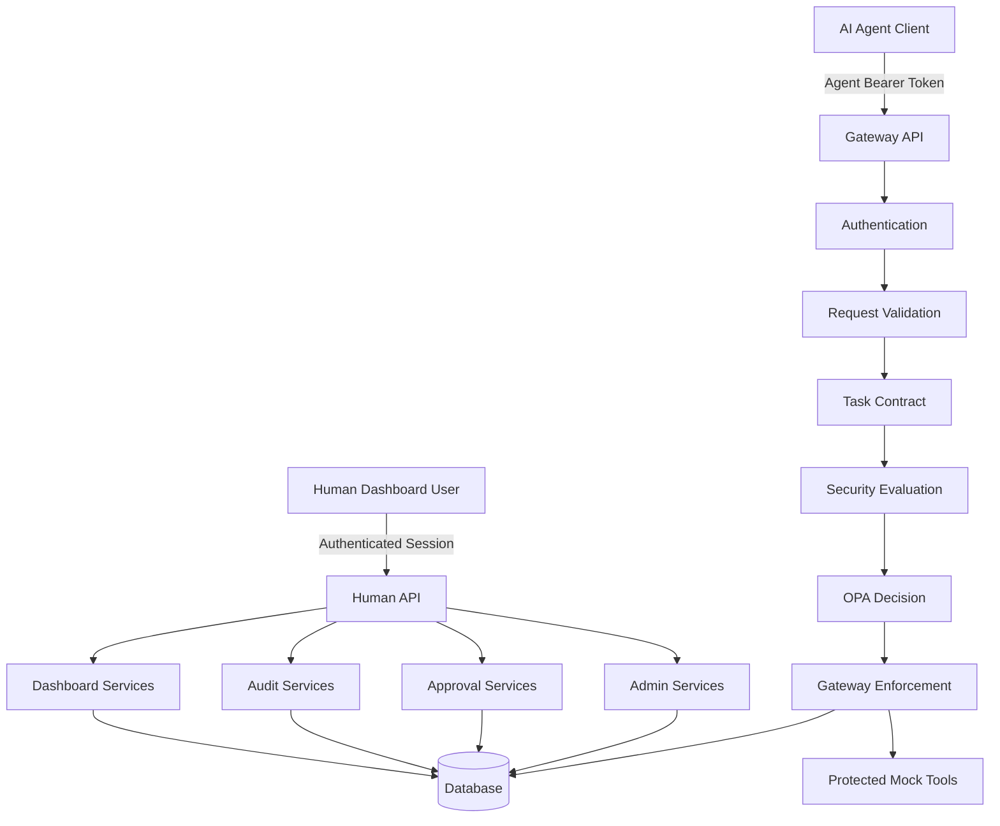

# AEGIS — API SPECIFICATION

**Project:** AEGIS  
**Document:** Backend API Specification  
**Version:** 1.0  
**Status:** Initial API Contract  
**API Style:** REST  
**Backend Framework:** FastAPI  
**Base API Path:** `/api/v1/`  
**Data Format:** JSON  
**Authentication:** Agent Bearer Credentials and Human User Sessions  
**Last Updated:** 14 November 2026

---

# 1. PURPOSE

This document defines the APIs used by the AEGIS backend.

It specifies:

- API endpoint names.
- HTTP methods.
- Authentication requirements.
- Request structures.
- Response structures.
- Status codes.
- Error handling.
- Pagination.
- Filtering.
- Request validation.
- API security.
- Agent-to-gateway communication.
- Dashboard-to-backend communication.

The frontend and simulated agents must follow these API contracts.

The backend must validate every request independently.

The API specification is a communication contract, not a replacement for the security policies defined in SECURITY_MODEL.md.

# 2. API ARCHITECTURE

AEGIS uses REST APIs for communication between:

1. Human users and the dashboard backend.
2. AI agents and the AEGIS Gateway.
3. The React frontend and backend services.

Internal service communication is not exposed directly to public clients.

## 2.1 High-Level API Flow



# 3. API GENERAL CONFIGURATION

## 3.1 Base URL

Local development:

```text
http://127.0.0.1:8000
```

API base path:

```text
/api/v1/
```

Example:

```text
http://127.0.0.1:8000/api/v1/agents
```

Production URLs must be configured separately.

## 3.2 Content Type

Requests and responses use:

```http
Content-Type: application/json
```

## 3.3 Data Format

- Use JSON.
- Use UTF-8 encoding.
- Use ISO 8601 timestamps.
- Use UTC for stored and transmitted timestamps.
- Use consistent field names.
- Use unique IDs for database entities.

Example:

```text
2026-11-14T10:30:00Z
```

## 3.4 API Versioning

All initial endpoints must use:

```text
/api/v1/
```

Do not introduce unversioned application endpoints.

Breaking API changes must use a planned version change rather than silently changing existing response formats.

# 4. AUTHENTICATION METHODS

AEGIS has two separate authentication systems.

## 4.1 Agent Authentication

Agents authenticate using individual bearer credentials.

Header:

```http
Authorization: Bearer <AGENT_TOKEN>
```

Requirements:

- Every agent must have a unique credential.
- Credentials must be generated securely.
- The backend stores credential digests, not original tokens.
- Revoked credentials must stop working.
- Disabled agents must be rejected.
- Tokens must never be included in request bodies.
- Tokens must never be logged.

The authenticated agent identity must be derived from the verified credential.

Do not trust an `agent_id` supplied by the agent as proof of identity.

## 4.2 Human User Authentication

Human users authenticate through the dashboard login process.

Initial approach:

- Username and password.
- Server-side password verification.
- Secure session creation.
- HTTP-only session cookie.
- Session expiry.
- Logout and session revocation.

For production, use:

- Secure cookies.
- Appropriate SameSite settings.
- HTTPS.
- CSRF protection for state-changing cookie-authenticated requests.
- Rate limiting.

Do not store human passwords or long-lived session secrets in browser local storage.

## 4.3 Role-Based Authorization

Initial human roles:

- ADMINISTRATOR.
- SECURITY_OPERATOR.
- REVIEWER.
- AUDITOR.

Every restricted endpoint must verify the user's role on the backend.

# 5. STANDARD RESPONSE STRUCTURE

Successful response:

```json
{
  "success": true,
  "data": {},
  "meta": {
    "request_id": "REQ-001"
  }
}
```

Error response:

```json
{
  "success": false,
  "error": {
    "code": "VALIDATION_ERROR",
    "message": "The submitted request is invalid."
  },
  "meta": {
    "request_id": "REQ-001"
  }
}
```

Rules:

- `success` identifies request processing success or failure.
- `data` contains the requested result.
- `error` contains a safe error description.
- `meta.request_id` identifies the operation.

A security BLOCK is a valid completed security decision, not necessarily an API processing error. Therefore, a correctly evaluated BLOCK response may have `success: true`.

# 6. HTTP STATUS CODES

Use these status codes consistently.

| Code | Meaning | Usage |
|---|---|---|
| 200 | OK | Successful retrieval or completed decision |
| 201 | Created | Resource created |
| 202 | Accepted | Processing or review is pending |
| 204 | No Content | Successful action without response body |
| 400 | Bad Request | Invalid general request |
| 401 | Unauthorized | Missing or invalid authentication |
| 403 | Forbidden | Authenticated user lacks permission |
| 404 | Not Found | Resource does not exist |
| 409 | Conflict | Duplicate or invalid state transition |
| 422 | Unprocessable Entity | Schema or validation failure |
| 429 | Too Many Requests | Rate limit exceeded |
| 500 | Internal Server Error | Unexpected server error |
| 502 | Bad Gateway | Invalid external service response |
| 503 | Service Unavailable | Required service unavailable |
| 504 | Gateway Timeout | Required upstream service timed out |

The API status code must describe the API operation correctly.

For example, an authenticated tool request that receives a policy BLOCK can return HTTP 200 with `decision: BLOCK`.

# 7. HEALTH AND SERVICE APIs

## 7.1 Application Health

**Endpoint:**

```http
GET /api/v1/health
```

Authentication: Not required.

Purpose:

Check whether the FastAPI application is running.

Example response:

```json
{
  "success": true,
  "data": {
    "status": "healthy",
    "application": "AEGIS"
  }
}
```

This endpoint must not reveal credentials, environment secrets or detailed internal configuration.

## 7.2 Service Status

**Endpoint:**

```http
GET /api/v1/dashboard/service-status
```

Authentication: Human user session.

Purpose:

Display the status of configured services.

Example response:

```json
{
  "success": true,
  "data": {
    "backend": "CONNECTED",
    "database": "CONNECTED",
    "opa": "CONNECTED",
    "gemini": "CONFIGURED"
  }
}
```

Gemini availability must be checked using a safe health or test mechanism.

Do not claim that Gemini is connected merely because an API key is configured.

# 8. HUMAN AUTHENTICATION APIs

## 8.1 User Login

**Endpoint:**

```http
POST /api/v1/auth/login
```

Authentication: Not required.

Request:

```json
{
  "username": "admin",
  "password": "user_password"
}
```

Backend actions:

1. Validate the input.
2. Retrieve the account.
3. Verify the password hash.
4. Check account status.
5. Create a server-managed session.
6. Set an appropriate session cookie.

Successful response:

```json
{
  "success": true,
  "data": {
    "user": {
      "id": "USR-001",
      "username": "admin",
      "role": "ADMINISTRATOR"
    }
  }
}
```

The session cookie must be set through the HTTP response and must not be included in JSON.

## 8.2 Current User

**Endpoint:**

```http
GET /api/v1/auth/me
```

Authentication: Human session.

Purpose:

Retrieve the currently authenticated user's information and role.

## 8.3 Logout

**Endpoint:**

```http
POST /api/v1/auth/logout
```

Authentication: Human session.

Purpose:

Revoke the current server-side session and clear the session cookie.

# 9. AGENT MANAGEMENT APIs

All agent management endpoints require an authorized human user.

## 9.1 List Agents

**Endpoint:**

```http
GET /api/v1/agents
```

Purpose:

Retrieve registered agents.

Query parameters:

- `status`
- `agent_type`
- `search`
- `page`
- `limit`

Example:

```http
GET /api/v1/agents?status=ACTIVE&page=1&limit=20
```

## 9.2 Create Agent

**Endpoint:**

```http
POST /api/v1/agents
```

Authentication: Administrator.

Request:

```json
{
  "name": "Research Agent",
  "agent_type": "RESEARCH",
  "description": "Collects public cybersecurity information"
}
```

Backend actions:

- Validate the agent name.
- Generate a unique agent ID.
- Create the agent record.
- Generate an individual agent credential.
- Store only its secure digest.
- Return the raw credential once when the authorized creation workflow requires it.

Example response:

```json
{
  "success": true,
  "data": {
    "agent": {
      "id": "research_01",
      "name": "Research Agent",
      "status": "ACTIVE"
    },
    "credential": {
      "token": "ONE_TIME_SECRET_VALUE",
      "display_once": true
    }
  }
}
```

The token must never be retrievable again through the normal agent details API.

The application should clearly warn the administrator to store it securely.

## 9.3 Agent Details

**Endpoint:**

```http
GET /api/v1/agents/{agent_id}
```

Purpose:

Retrieve agent details and relevant assigned contract information.

Never return credential digests or original tokens.

## 9.4 Update Agent

**Endpoint:**

```http
PATCH /api/v1/agents/{agent_id}
```

Authentication: Administrator.

Allowed updates must be restricted to approved editable fields, such as:

- Name.
- Description.
- Status.

Agent identity must not be freely replaced.

## 9.5 Revoke Agent Credentials

**Endpoint:**

```http
POST /api/v1/agents/{agent_id}/revoke-credentials
```

Authentication: Administrator.

Purpose:

Revoke active credentials associated with an agent.

A revoked credential must fail subsequent authentication attempts.

# 10. TASK CONTRACT APIs

All Task Contract management endpoints require authorized human access.

## 10.1 List Contracts

**Endpoint:**

```http
GET /api/v1/contracts
```

Query parameters:

- `agent_id`
- `status`
- `page`
- `limit`

## 10.2 Create Contract

**Endpoint:**

```http
POST /api/v1/contracts
```

Authentication: Administrator.

Request:

```json
{
  "agent_id": "admin_01",
  "task_description": "Read-only audit of test records",
  "allowed_tools": [
    "test_database"
  ],
  "allowed_operations": [
    "read"
  ],
  "allowed_resources": [
    "test_records"
  ],
  "restricted_operations": [
    "delete",
    "bulk_export"
  ],
  "expires_at": "2026-11-15T18:00:00Z"
}
```

Backend actions:

1. Verify the administrator.
2. Check agent existence.
3. Validate tool identifiers.
4. Validate operation compatibility.
5. Validate resource scope.
6. Validate expiry.
7. Create the contract.
8. Record its initial version.
9. Record the administrative action.

## 10.3 Contract Details

**Endpoint:**

```http
GET /api/v1/contracts/{contract_id}
```

Return:

- Contract ID.
- Agent ID.
- Version.
- Task description.
- Allowed tools.
- Allowed operations.
- Allowed resources.
- Restrictions.
- Approval requirements.
- Status.
- Expiry.
- Creation information.

## 10.4 Update Contract

**Endpoint:**

```http
PATCH /api/v1/contracts/{contract_id}
```

Authentication: Administrator.

Important behaviour:

A contract update must create or preserve a new version.

It must not silently destroy historical contract information.

Use a version check or `If-Match` mechanism to prevent conflicting updates.

The backend must revalidate pending requests after a contract changes.

# 11. TOOL REGISTRY API

## 11.1 List Registered Tools

**Endpoint:**

```http
GET /api/v1/tools
```

Authentication: Authorized human user.

Purpose:

Display registered mock tools and supported operations.

Example response:

```json
{
  "success": true,
  "data": [
    {
      "tool_id": "test_database",
      "name": "Test Database",
      "supported_operations": [
        "read",
        "create",
        "update",
        "delete"
      ],
      "status": "ACTIVE"
    }
  ]
}
```

A tool's presence in the database does not automatically make it executable.

Only backend-registered tool adapters may execute.

# 12. MAIN AEGIS GATEWAY API

This is the central API of AEGIS.

## 12.1 Submit Tool Request

**Endpoint:**

```http
POST /api/v1/tool-requests
```

Authentication: Agent Bearer Token.

Required headers:

```http
Authorization: Bearer <AGENT_TOKEN>
Content-Type: application/json
Idempotency-Key: <UNIQUE_REQUEST_KEY>
```

The `Idempotency-Key` is used for supported operations to help prevent duplicate side effects.

Request:

```json
{
  "tool": "test_database",
  "operation": "delete",
  "resource": "test_records",
  "parameters": {
    "record_id": "TEST-001"
  }
}
```

The request body must not be trusted to establish agent identity.

The backend derives the agent identity from the validated bearer credential.

## 12.2 Gateway Processing

The endpoint must:

1. Authenticate the agent.
2. Validate the request schema.
3. Generate a unique request ID.
4. Normalize the request.
5. Retrieve the active Task Contract.
6. Apply deterministic restrictions.
7. Request Gemini analysis when required.
8. Validate advisory output.
9. Submit final policy input to OPA.
10. Validate the OPA response.
11. Enforce ALLOW, BLOCK or REVIEW.
12. Record the decision.
13. Execute only permitted requests.
14. Return a structured result.

## 12.3 ALLOW Response

HTTP status: 200.

Example:

```json
{
  "success": true,
  "data": {
    "request_id": "REQ-001",
    "decision": "ALLOW",
    "execution": {
      "status": "COMPLETED",
      "tool": "test_database"
    },
    "reason": "The request passed the required policy checks."
  }
}
```

The execution status must reflect the real result.

Do not return COMPLETED before the tool has actually finished.

## 12.4 BLOCK Response

HTTP status: 200 for a successfully evaluated policy decision.

Example:

```json
{
  "success": true,
  "data": {
    "request_id": "REQ-002",
    "decision": "BLOCK",
    "execution": {
      "status": "NOT_EXECUTED"
    },
    "reason_code": "OPERATION_NOT_PERMITTED",
    "reason": "Delete is not permitted by the active Task Contract."
  }
}
```

The protected tool must not be called.

## 12.5 REVIEW Response

HTTP status: 202 when the request has been successfully placed into a pending approval state.

Example:

```json
{
  "success": true,
  "data": {
    "request_id": "REQ-003",
    "decision": "REVIEW",
    "execution": {
      "status": "PAUSED"
    },
    "approval_id": "APR-001",
    "reason": "This operation requires human approval."
  }
}
```

The request must not execute while approval is pending.

## 12.6 Get Request Details

**Endpoint:**

```http
GET /api/v1/tool-requests/{request_id}
```

Authentication: Authorized human user.

Return:

- Request details.
- Agent information.
- Task Contract reference.
- Policy decision.
- Gemini advisory status where applicable.
- Execution result.
- Approval details.
- Audit event references.

Sensitive parameters must be masked where necessary.

## 12.7 List Requests

**Endpoint:**

```http
GET /api/v1/tool-requests
```

Query parameters:

- `agent_id`
- `decision`
- `tool`
- `operation`
- `resource`
- `execution_status`
- `start_date`
- `end_date`
- `page`
- `limit`

Example:

```http
GET /api/v1/tool-requests?decision=BLOCK&page=1&limit=20
```

Only authorized human users may access the administrative request history.

# 13. HUMAN APPROVAL APIs

These APIs are for authenticated and authorized human reviewers.

## 13.1 List Approval Requests

**Endpoint:**

```http
GET /api/v1/approvals
```

Query parameters:

- `status`
- `agent_id`
- `start_date`
- `end_date`
- `page`
- `limit`

## 13.2 Approval Details

**Endpoint:**

```http
GET /api/v1/approvals/{approval_id}
```

Return:

- Approval ID.
- Request ID.
- Agent.
- Task Contract reference.
- Requested tool.
- Operation.
- Resource.
- Review reason.
- Expiry.
- Current status.

## 13.3 Approve Request

**Endpoint:**

```http
POST /api/v1/approvals/{approval_id}/approve
```

Authentication: Authorized Reviewer or Administrator.

Request:

```json
{
  "comment": "Approved for the specified reporting request."
}
```

The backend must:

1. Verify reviewer identity and role.
2. Verify approval status.
3. Verify expiry.
4. Verify request fingerprint.
5. Check current agent status.
6. Check the current Task Contract.
7. Re-evaluate relevant OPA policies.
8. Execute only if all requirements pass.
9. Record reviewer and execution information.

An approval must not bypass explicit hard-deny restrictions.

## 13.4 Reject Request

**Endpoint:**

```http
POST /api/v1/approvals/{approval_id}/reject
```

Request:

```json
{
  "comment": "The export is not required for this task."
}
```

The backend must:

- Verify reviewer authorization.
- Verify that the approval is pending.
- Mark it as rejected.
- Prevent tool execution.
- Record the rejection event.

# 14. AUDIT APIs

## 14.1 List Audit Events

**Endpoint:**

```http
GET /api/v1/audit-events
```

Authentication: Auditor, Security Operator or Administrator.

Query parameters:

- `request_id`
- `agent_id`
- `event_type`
- `start_date`
- `end_date`
- `page`
- `limit`

## 14.2 Audit Event Details

**Endpoint:**

```http
GET /api/v1/audit-events/{event_id}
```

Return:

- Event ID.
- Request ID.
- Actor type.
- Actor ID.
- Event type.
- Event details.
- Timestamp.

Audit APIs must be read-only for normal dashboard users.

# 15. DASHBOARD APIs

## 15.1 Dashboard Overview

**Endpoint:**

```http
GET /api/v1/dashboard/overview
```

Return:

- Total requests.
- Allowed requests.
- Blocked requests.
- Pending reviews.
- Failed executions.
- Active agents.

Example:

```json
{
  "success": true,
  "data": {
    "total_requests": 0,
    "allowed_requests": 0,
    "blocked_requests": 0,
    "pending_reviews": 0,
    "failed_executions": 0,
    "active_agents": 0
  }
}
```

Values must come from actual stored records.

## 15.2 Dashboard Activity

**Endpoint:**

```http
GET /api/v1/dashboard/activity
```

Query parameters:

- `start_date`
- `end_date`
- `interval`

Return time-based request statistics.

## 15.3 Service Status

**Endpoint:**

```http
GET /api/v1/dashboard/service-status
```

Return safe service connectivity information.

Do not expose raw environment configuration.

# 16. SETTINGS APIs

Settings endpoints must expose only authorized application configuration.

Proposed endpoints:

```http
GET /api/v1/settings
PATCH /api/v1/settings
```

These endpoints must be implemented only for settings that have a safe and clear administrative workflow.

Do not expose or return:

- Raw Gemini API key.
- Agent credentials.
- Database passwords.
- Internal authentication secrets.
- Unrestricted OPA configuration.

If a setting is not safely editable, expose it as read-only.

# 17. REQUEST LIFECYCLE

A tool request may move through the following states:

```text
RECEIVED
   |
   v
VALIDATING
   |
   v
EVALUATING
   |
   +---- BLOCKED
   |
   +---- REVIEW_PENDING
   |          |
   |          +---- APPROVED
   |          |        |
   |          |        v
   |          |     REVALIDATING
   |          |        |
   |          |        v
   |          |     EXECUTING
   |          |
   |          +---- REJECTED
   |          |
   |          +---- EXPIRED
   |
   +---- ALLOWED
              |
              v
          EXECUTING
              |
          +---+---+
          |       |
          v       v
       EXECUTED FAILED
```

The implementation may record policy decisions separately from request execution states.

For example, a request can have a final decision of ALLOW and an execution status of FAILED.

These are different facts and must not be merged into one status.

# 18. PAGINATION AND FILTERING

List endpoints must support pagination.

Recommended parameters:

```text
?page=1&limit=20
```

Rules:

- Default page: 1.
- Default limit: 20.
- Maximum limit: 100.
- Page must be a positive integer.
- Limit must be within the allowed range.
- Filtering must be validated.
- Ordering must be deterministic.

Example metadata:

```json
{
  "success": true,
  "data": [],
  "meta": {
    "page": 1,
    "limit": 20,
    "total": 0,
    "total_pages": 0
  }
}
```

# 19. API ERROR CODES

Use consistent error codes.

| Code | Meaning |
|---|---|
| AUTHENTICATION_REQUIRED | Authentication missing |
| INVALID_CREDENTIAL | Invalid agent or user credential |
| AGENT_DISABLED | Agent is disabled |
| AGENT_NOT_FOUND | Agent does not exist |
| CONTRACT_NOT_FOUND | Contract does not exist |
| CONTRACT_EXPIRED | Contract has expired |
| CONTRACT_INVALID | Contract validation failed |
| TOOL_NOT_ALLOWED | Tool is outside the permitted scope |
| OPERATION_NOT_PERMITTED | Operation is forbidden |
| RESOURCE_OUT_OF_SCOPE | Resource is not permitted |
| INVALID_TOOL_PARAMETERS | Tool parameters are invalid |
| OPA_UNAVAILABLE | Policy service unavailable |
| OPA_INVALID_RESPONSE | Invalid policy result |
| GEMINI_UNAVAILABLE | Gemini service unavailable |
| GEMINI_INVALID_OUTPUT | Invalid Gemini response |
| APPROVAL_REQUIRED | Human approval is needed |
| APPROVAL_EXPIRED | Approval expired |
| APPROVAL_NOT_AUTHORIZED | User cannot approve |
| REQUEST_CONFLICT | Invalid request state transition |
| TOOL_EXECUTION_FAILED | Protected tool execution failed |
| RATE_LIMIT_EXCEEDED | Request limit reached |
| DATABASE_UNAVAILABLE | Database is unavailable |
| INTERNAL_SERVER_ERROR | Unexpected application failure |

Error messages must be safe and must not expose internal secrets.

# 20. API SECURITY REQUIREMENTS

Every endpoint must follow appropriate security rules.

## Agent Endpoints

- Require agent authentication.
- Derive identity from validated credentials.
- Apply request size limits.
- Validate all inputs.
- Rate-limit requests where appropriate.

## Human Endpoints

- Require user sessions.
- Enforce role permissions.
- Protect state-changing cookie-authenticated requests against CSRF.
- Apply login rate limiting.
- Expire sessions.
- Avoid storing tokens in frontend storage.

## Internal Service APIs

- Keep OPA private.
- Keep protected mock tools internal.
- Make Gemini calls from the backend only.
- Do not expose internal services directly to browsers.

## General API Rules

- Apply appropriate CORS settings.
- Use parameterized database operations.
- Validate content type.
- Set reasonable request size limits.
- Use timeouts.
- Do not return stack traces.
- Use HTTPS in production.

# 21. IDEMPOTENCY AND DUPLICATE REQUESTS

Tool operations that cause side effects must support safe retry behaviour.

Use an `Idempotency-Key` for appropriate agent requests.

The backend must:

1. Associate the key with the authenticated agent.
2. Store the request fingerprint.
3. Detect a repeated key with the same request.
4. Return the existing outcome rather than executing a duplicate.
5. Reject reuse of the same key with different request content.

Idempotency records must follow a defined retention period.

# 22. INTERNAL OPA API COMMUNICATION

OPA is an internal service.

The browser and AI agents must never call OPA directly.

The backend creates the policy input and sends it to OPA.

The backend validates the OPA response.

The gateway enforces the resulting decision.

OPA service endpoints and package names must follow the actual Rego policy implementation.

# 23. GEMINI API COMMUNICATION

Gemini is also an internal backend integration.

The browser and agent clients must not call Gemini using the AEGIS backend secret.

The backend must:

- Read the model name from configuration.
- Apply request timeouts.
- Validate context.
- Avoid unnecessary calls.
- Validate structured responses.
- Handle quotas and failures.
- Avoid logging sensitive prompts.

Gemini output remains advisory.

# 24. API DOCUMENTATION AND TESTING

FastAPI should generate OpenAPI documentation from implemented schemas.

The generated documentation must match the actual implementation.

Required tests:

- Authentication.
- Request validation.
- Agent registration.
- Contract operations.
- Gateway decisions.
- OPA failures.
- Gemini failures.
- Approval.
- Audit access.
- Dashboard data.
- Rate limits.
- Idempotency.

The API specification must be updated whenever an approved API contract changes.

# 25. API ACCEPTANCE CRITERIA

The API is complete for the MVP when:

1. All defined endpoints have working implementations.
2. Authentication works for agents and human users.
3. Authorization works for restricted routes.
4. Request and response schemas are validated.
5. API error responses are consistent.
6. Gateway decisions work correctly.
7. Blocked requests never execute tools.
8. Review requests remain paused.
9. Approval is revalidated.
10. Audit records are accessible to authorized users.
11. Dashboard data comes from actual backend records.
12. Endpoint tests pass.
13. OpenAPI documentation matches implementation.
14. Sensitive internal services are not exposed to public clients.

# 26. OFFICIAL API REFERENCES

- FastAPI: https://fastapi.tiangolo.com/
- FastAPI Security: https://fastapi.tiangolo.com/tutorial/security/
- Pydantic: https://docs.pydantic.dev/
- OpenAPI: https://spec.openapis.org/oas/latest.html
- HTTPX: https://www.python-httpx.org/
- Open Policy Agent: https://www.openpolicyagent.org/docs/

---

**END OF API_SPECIFICATION.md**