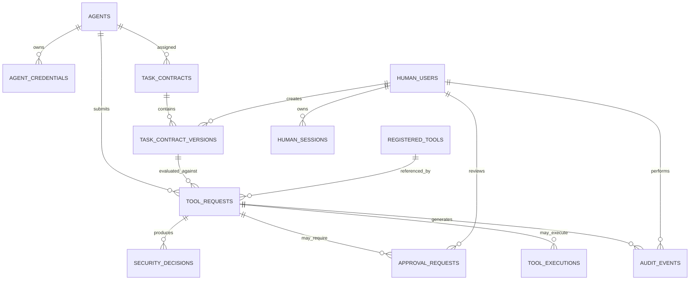

# AEGIS — DATABASE DESIGN AND DATA MODEL

**Project:** AEGIS  
**Document:** Database Design Specification  
**Version:** 1.0  
**Status:** Initial Database Specification  
**Initial Database:** SQLite  
**Future Database:** PostgreSQL  
**ORM:** SQLAlchemy 2  
**Migration Tool:** Alembic  
**Last Updated:** 14 November 2026

---

# 1. PURPOSE

This document defines how AEGIS will store, organize, access and protect its application data.

It includes:

- Database architecture.
- Database technology.
- Entity relationships.
- Table structures.
- Field definitions.
- Primary and foreign keys.
- Indexes.
- Data validation.
- Database access rules.
- Audit storage.
- Migration strategy.
- Backup and recovery.
- Security requirements.

The database is an important part of AEGIS because it stores authoritative information about agent identities, Task Contracts, security decisions and protected tool requests.

All database implementations must follow this document and the approved architecture.

# 2. DATABASE OBJECTIVES

The database must:

1. Store registered AI agents.
2. Store agent credential information securely.
3. Store Task Contracts and their versions.
4. Store registered tool metadata.
5. Store incoming protected tool requests.
6. Store security decisions.
7. Store Gemini analysis metadata.
8. Store human approval requests.
9. Store actual tool execution results.
10. Store audit events.
11. Store administrator and reviewer accounts.
12. Provide accurate dashboard information.
13. Maintain relationships between related records.
14. Support future migration to PostgreSQL.

# 3. DATABASE TECHNOLOGY

## 3.1 Initial Database: SQLite

SQLite will be used for the first local MVP.

Reasons:

- Free and open source.
- No separate database server required.
- Easy local setup.
- Suitable for a controlled prototype.
- Works with SQLAlchemy.
- Supports database migrations through Alembic.

SQLite is the initial development choice, not necessarily the final production database.

## 3.2 Future Database: PostgreSQL

PostgreSQL may be introduced when AEGIS is prepared for hosted deployment or multiple concurrent users.

The backend must use SQLAlchemy so that the application does not depend heavily on database-specific query behaviour.

## 3.3 ORM: SQLAlchemy 2

Use SQLAlchemy 2 for:

- Database models.
- Relationships.
- Queries.
- Transactions.
- Database sessions.
- Data persistence.

## 3.4 Migration Tool: Alembic

Use Alembic for:

- Initial database creation.
- Table modifications.
- Column changes.
- Index creation.
- Relationship changes.
- Schema version management.

Do not modify production database structure manually outside approved migrations.

# 4. DATABASE ARCHITECTURE

The database uses a relational structure.

Each important entity has a separate table.

The main relationship structure is:



This is the logical relationship model. The actual SQLAlchemy implementation must apply suitable foreign-key constraints.

# 5. DATABASE ENTITY LIST

The initial MVP requires the following entities.

| Table | Purpose |
|---|---|
| `agents` | Stores registered agent information |
| `agent_credentials` | Stores secure credential digests |
| `task_contracts` | Stores logical Task Contract records |
| `task_contract_versions` | Stores individual contract versions |
| `registered_tools` | Stores approved tool metadata |
| `human_users` | Stores administrator and reviewer accounts |
| `human_sessions` | Stores server-managed session information |
| `tool_requests` | Stores incoming tool requests |
| `security_decisions` | Stores policy and decision results |
| `approval_requests` | Stores human approval information |
| `tool_executions` | Stores actual execution results |
| `audit_events` | Stores security activity |
| `idempotency_records` | Prevents duplicate request execution |

# 6. TABLE DESIGN

## 6.1 AGENTS TABLE

**Table Name:** `agents`

**Purpose:** Store registered AI agent information.

| Field | Type | Constraints | Description |
|---|---|---|---|
| id | String | Primary Key | Unique agent identifier |
| name | String | Not Null | Agent name |
| agent_type | String | Not Null | Research, Finance or Admin |
| description | Text | Nullable | Agent purpose |
| status | String | Not Null | ACTIVE, DISABLED or REVOKED |
| created_at | DateTime | Not Null | Creation time |
| updated_at | DateTime | Not Null | Last update |

### Rules

- Agent IDs must be unique.
- The system must reject duplicate registrations.
- Disabled agents cannot authenticate.
- Revoked agents cannot authenticate.
- Agent identity must be established through authentication.
- Agent names are display information, not proof of identity.

## 6.2 AGENT_CREDENTIALS TABLE

**Table Name:** `agent_credentials`

**Purpose:** Store information about agent authentication credentials.

| Field | Type | Constraints | Description |
|---|---|---|---|
| id | String | Primary Key | Credential record ID |
| agent_id | String | Foreign Key | Related agent |
| credential_digest | String | Unique, Not Null | Secure token digest |
| credential_prefix | String | Nullable | Non-secret identification prefix |
| status | String | Not Null | ACTIVE, REVOKED or EXPIRED |
| expires_at | DateTime | Nullable | Credential expiry |
| revoked_at | DateTime | Nullable | Revocation time |
| last_used_at | DateTime | Nullable | Last successful use |
| created_at | DateTime | Not Null | Creation time |

### Rules

- Never store raw agent tokens.
- Store only a secure digest.
- Credential digests must be unique.
- Revoke compromised credentials.
- Credentials must belong to registered agents.
- Do not include credentials in audit logs.

Use a cryptographic hash suitable for high-entropy random tokens, and compare digests safely.

## 6.3 TASK_CONTRACTS TABLE

**Table Name:** `task_contracts`

**Purpose:** Store the logical identity of a Task Contract.

| Field | Type | Constraints | Description |
|---|---|---|---|
| id | String | Primary Key | Contract ID |
| agent_id | String | Foreign Key | Assigned agent |
| current_version | Integer | Not Null | Active contract version |
| created_at | DateTime | Not Null | Creation time |
| updated_at | DateTime | Not Null | Last change |

### Rules

- Every contract belongs to a registered agent.
- A contract can have multiple versions.
- A contract update must preserve previous versions.
- Active contract information must be retrieved from the backend.
- Agents cannot change their own contracts.

## 6.4 TASK_CONTRACT_VERSIONS TABLE

**Table Name:** `task_contract_versions`

**Purpose:** Store individual versions of a Task Contract.

| Field | Type | Constraints | Description |
|---|---|---|---|
| id | String | Primary Key | Contract version record ID |
| contract_id | String | Foreign Key | Logical contract ID |
| version | Integer | Not Null | Version number |
| task_description | Text | Not Null | Assigned task |
| allowed_tools | JSON | Not Null | Permitted tool IDs |
| allowed_operations | JSON | Not Null | Permitted operations |
| allowed_resources | JSON | Not Null | Permitted resources |
| restricted_operations | JSON | Not Null | Restricted operations |
| approval_requirements | JSON | Not Null | Approval rules |
| status | String | Not Null | ACTIVE, INACTIVE or EXPIRED |
| expires_at | DateTime | Not Null | Contract expiry |
| created_by | String | Foreign Key | Authorized administrator |
| created_at | DateTime | Not Null | Creation time |

### Rules

- Each contract version must be unique.
- Use a unique constraint on `contract_id` and `version`.
- The current version must match the version selected by the logical contract.
- Historical versions must be preserved.
- Contract data must be schema-validated before storage.
- An expired version cannot authorize new requests.
- Existing requests must record which contract version was evaluated.

The JSON columns are structured data, not unrestricted policy code. Use Pydantic validation and Rego policy checks.

## 6.5 REGISTERED_TOOLS TABLE

**Table Name:** `registered_tools`

**Purpose:** Store information about approved tools.

| Field | Type | Constraints | Description |
|---|---|---|---|
| id | String | Primary Key | Tool ID |
| name | String | Unique, Not Null | Tool name |
| description | Text | Nullable | Tool purpose |
| supported_operations | JSON | Not Null | Supported operations |
| parameter_schema | JSON | Not Null | Accepted parameter structure |
| status | String | Not Null | ACTIVE or DISABLED |
| created_at | DateTime | Not Null | Creation time |
| updated_at | DateTime | Not Null | Last update |

### Rules

- Tool IDs must be unique.
- Only approved tools can be selected in Task Contracts.
- Supported operations must be validated.
- Disabled tools cannot execute.
- Database records must not dynamically create executable code.

The actual executable adapters must be explicitly registered in backend code.

A database entry alone must never make a new tool executable.

## 6.6 HUMAN_USERS TABLE

**Table Name:** `human_users`

**Purpose:** Store dashboard user accounts.

| Field | Type | Constraints | Description |
|---|---|---|---|
| id | String | Primary Key | User ID |
| username | String | Unique, Not Null | Login username |
| password_hash | String | Not Null | Secure password hash |
| role | String | Not Null | User role |
| status | String | Not Null | ACTIVE or DISABLED |
| created_at | DateTime | Not Null | Creation time |
| updated_at | DateTime | Not Null | Last update |

### Initial Roles

- ADMINISTRATOR.
- SECURITY_OPERATOR.
- REVIEWER.
- AUDITOR.

### Rules

- Store password hashes, never plain passwords.
- Use a maintained Argon2id password-hashing implementation.
- Validate role permissions on the backend.
- Prevent disabled users from logging in.
- Avoid exposing password hashes through API responses.

## 6.7 HUMAN_SESSIONS TABLE

**Table Name:** `human_sessions`

**Purpose:** Store server-managed human login sessions.

| Field | Type | Constraints | Description |
|---|---|---|---|
| id | String | Primary Key | Session ID |
| user_id | String | Foreign Key | Session owner |
| session_digest | String | Unique, Not Null | Session token digest |
| expires_at | DateTime | Not Null | Expiry time |
| revoked_at | DateTime | Nullable | Revocation time |
| created_at | DateTime | Not Null | Creation time |
| last_used_at | DateTime | Nullable | Last activity |

### Rules

- Do not store the original session token.
- Expired sessions must be rejected.
- Logout must revoke the active session.
- Disabled users must not retain usable sessions.
- Session cookies must use appropriate security settings.

## 6.8 TOOL_REQUESTS TABLE

**Table Name:** `tool_requests`

**Purpose:** Store all incoming protected tool requests.

| Field | Type | Constraints | Description |
|---|---|---|---|
| id | String | Primary Key | Request ID |
| agent_id | String | Foreign Key | Requesting agent |
| contract_id | String | Foreign Key | Related contract |
| contract_version | Integer | Not Null | Contract version used |
| tool_id | String | Foreign Key | Requested tool |
| operation | String | Not Null | Requested operation |
| resource | String | Not Null | Target resource |
| parameters | JSON | Not Null | Sanitized request parameters |
| request_fingerprint | String | Not Null | Request content fingerprint |
| status | String | Not Null | Processing status |
| received_at | DateTime | Not Null | Request time |
| completed_at | DateTime | Nullable | Completion time |

### Request Status Values

- RECEIVED.
- VALIDATING.
- EVALUATING.
- ALLOWED.
- BLOCKED.
- REVIEW_PENDING.
- REVALIDATING.
- EXECUTING.
- EXECUTED.
- FAILED.
- EXPIRED.

### Rules

- Every request must have a unique server-generated ID.
- Agent identity must come from authentication.
- The contract ID and version used for evaluation must be recorded.
- Parameters must be validated and sanitized.
- Sensitive information must be excluded or masked.
- A blocked request must never be recorded as successfully executed.
- A decision and an execution result must remain separate concepts.

## 6.9 SECURITY_DECISIONS TABLE

**Table Name:** `security_decisions`

**Purpose:** Store results from security evaluation stages.

| Field | Type | Constraints | Description |
|---|---|---|---|
| id | String | Primary Key | Decision record ID |
| request_id | String | Foreign Key | Related request |
| stage | String | Not Null | Evaluation stage |
| decision | String | Not Null | ALLOW, BLOCK or REVIEW |
| reason_code | String | Not Null | Machine-readable reason |
| reason | Text | Nullable | Human-readable explanation |
| policy_version | String | Nullable | Policy version |
| gemini_status | String | Nullable | Model analysis status |
| created_at | DateTime | Not Null | Decision time |

### Evaluation Stages

Possible values:

- PRECHECK.
- CONTEXT_ANALYSIS.
- FINAL_POLICY.
- APPROVAL_REVALIDATION.

### Rules

- Record the final OPA decision.
- Preserve the contextual analysis status where applicable.
- Do not label Gemini recommendations as final permissions.
- Keep evaluation stage and final decision distinguishable.
- Record failures separately from explicit policy denials.

Multiple decision records may exist for one request.

## 6.10 APPROVAL_REQUESTS TABLE

**Table Name:** `approval_requests`

**Purpose:** Store human review requests.

| Field | Type | Constraints | Description |
|---|---|---|---|
| id | String | Primary Key | Approval ID |
| request_id | String | Foreign Key | Related request |
| request_fingerprint | String | Not Null | Approved request content |
| status | String | Not Null | Approval status |
| review_reason | Text | Not Null | Why review is required |
| expires_at | DateTime | Not Null | Approval deadline |
| reviewer_id | String | Foreign Key, Nullable | Reviewing user |
| reviewer_comment | Text | Nullable | Reviewer explanation |
| decided_at | DateTime | Nullable | Review decision time |
| created_at | DateTime | Not Null | Creation time |

### Approval Status Values

- PENDING.
- APPROVED.
- REJECTED.
- EXPIRED.
- CANCELLED.

### Rules

- Approval must be linked to the original request.
- Approval must be time-limited.
- Only authorized reviewers can decide.
- Approval cannot be reused for a different request.
- Modified requests must be rejected.
- Contract and security conditions must be revalidated before execution.
- Hard-deny restrictions cannot be overridden by approval.

A request may have approval history, but only one current valid approval process may be active for a particular request at a time.

## 6.11 TOOL_EXECUTIONS TABLE

**Table Name:** `tool_executions`

**Purpose:** Store actual protected tool execution results.

| Field | Type | Constraints | Description |
|---|---|---|---|
| id | String | Primary Key | Execution ID |
| request_id | String | Foreign Key | Related request |
| tool_id | String | Foreign Key | Executed tool |
| operation | String | Not Null | Executed operation |
| status | String | Not Null | Execution status |
| result_summary | Text | Nullable | Safe result summary |
| error_code | String | Nullable | Execution error |
| started_at | DateTime | Not Null | Execution start |
| completed_at | DateTime | Nullable | Execution completion |
| duration_ms | Integer | Nullable | Execution duration |

### Execution Status Values

- STARTED.
- COMPLETED.
- FAILED.
- CANCELLED.

### Rules

- Execution records must be created only when a tool execution is attempted.
- BLOCK requests must not have successful execution records.
- Store safe summaries rather than unnecessary sensitive tool output.
- Execution errors must be recorded.
- Retries must not cause uncontrolled duplicate side effects.

## 6.12 AUDIT_EVENTS TABLE

**Table Name:** `audit_events`

**Purpose:** Maintain a history of important security and application events.

| Field | Type | Constraints | Description |
|---|---|---|---|
| id | String | Primary Key | Event ID |
| request_id | String | Foreign Key, Nullable | Related request |
| actor_type | String | Not Null | AGENT, USER or SYSTEM |
| actor_id | String | Nullable | Actor identifier |
| event_type | String | Not Null | Event category |
| event_data | JSON | Not Null | Sanitized event details |
| created_at | DateTime | Not Null | Event timestamp |

### Event Examples

- AGENT_CREATED.
- CREDENTIAL_REVOKED.
- CONTRACT_CREATED.
- CONTRACT_UPDATED.
- REQUEST_RECEIVED.
- IDENTITY_VERIFIED.
- CONTRACT_VALIDATED.
- REQUEST_BLOCKED.
- POLICY_EVALUATED.
- APPROVAL_CREATED.
- REQUEST_APPROVED.
- REQUEST_REJECTED.
- TOOL_EXECUTED.
- TOOL_EXECUTION_FAILED.

### Rules

- Important security actions must generate events.
- Audit events must be linked to relevant request IDs.
- Do not store credentials or private secrets.
- Restrict event modification through application permissions.
- Do not provide ordinary users with unrestricted delete or update operations.
- Include enough information to explain decisions.

The initial system provides application-level audit controls. It does not automatically provide cryptographic tamper-proof storage.

## 6.13 IDEMPOTENCY_RECORDS TABLE

**Table Name:** `idempotency_records`

**Purpose:** Prevent duplicate execution of supported requests.

| Field | Type | Constraints | Description |
|---|---|---|---|
| id | String | Primary Key | Record ID |
| agent_id | String | Foreign Key | Requesting agent |
| idempotency_key | String | Not Null | Client-supplied key |
| request_fingerprint | String | Not Null | Request content fingerprint |
| request_id | String | Foreign Key | Original request |
| status | String | Not Null | PROCESSING or COMPLETED |
| expires_at | DateTime | Not Null | Record expiry |
| created_at | DateTime | Not Null | Creation time |

### Rules

- The key must be unique within the authenticated agent scope.
- Repeated identical requests must not create duplicate side effects.
- Reusing a key with different request content must be rejected.
- Expired records can be cleaned according to a defined retention policy.
- The same idempotency key must not be trusted across different agent identities.

# 7. ENTITY RELATIONSHIPS

The main relationships are:

## 7.1 Agent Relationships

- One agent can have multiple credentials.
- One agent can have one or more Task Contracts.
- One agent can submit multiple tool requests.
- One agent can appear in multiple audit events.

## 7.2 Contract Relationships

- One logical Task Contract can have multiple versions.
- Each version belongs to one logical contract.
- Each contract belongs to one agent.
- Every tool request records the contract version used.

## 7.3 Request Relationships

- One request belongs to one agent.
- One request references the contract used.
- One request references a registered tool.
- One request may have multiple security decision records.
- One request may have an approval process.
- One request may have a tool execution record.
- One request may have multiple audit events.

## 7.4 Human User Relationships

- One user may review multiple approval requests.
- One user may create multiple Task Contract versions.
- One user may generate multiple audit events.
- One user may have multiple historical sessions.

# 8. PRIMARY KEYS AND IDENTIFIERS

Use unique identifiers for all main entities.

Recommended approach:

- UUIDs for internal entity IDs.
- Clearly readable request IDs for dashboard display if desired.
- Contract versions as incrementing integers within a contract.
- Unique indexes for credentials and tool identifiers.

Example:

```text
Agent ID: research_01
Contract ID: TC-001
Request ID: REQ-001
Approval ID: APR-001
Event ID: EVT-001
```

Readable IDs must still be unique.

Do not depend on sequential IDs as authentication secrets.

# 9. INDEXING STRATEGY

Add indexes for fields frequently used in lookups and filtering.

Recommended indexes:

| Table | Index | Purpose |
|---|---|---|
| agents | status | Agent filtering |
| agent_credentials | credential_digest | Authentication lookup |
| task_contracts | agent_id | Agent contract lookup |
| task_contract_versions | contract_id, version | Version retrieval |
| registered_tools | name | Tool lookup |
| tool_requests | agent_id | Agent request history |
| tool_requests | received_at | Time-based filtering |
| tool_requests | status | Request status filtering |
| security_decisions | request_id | Decision history |
| approval_requests | status | Pending approval lookup |
| approval_requests | expires_at | Expiry checks |
| tool_executions | request_id | Execution lookup |
| audit_events | request_id | Request audit history |
| audit_events | created_at | Event history filtering |
| idempotency_records | agent_id, idempotency_key | Duplicate detection |

Use unique composite constraints where required.

Do not create every possible index without considering write performance and storage.

# 10. DATA VALIDATION RULES

All database data must be validated before storage.

Requirements:

1. Required fields cannot be missing.
2. IDs must be unique.
3. Foreign-key references must be valid.
4. Enum-like values must be restricted.
5. Dates must be valid.
6. Task Contract data must match its approved schema.
7. Tool operations must exist in the tool registry.
8. JSON fields must have defined structures.
9. Request parameters must be validated.
10. Sensitive data must be excluded or masked.

Database constraints must support backend validation rather than replace it.

# 11. DATABASE ACCESS ARCHITECTURE

Database access must remain inside the backend.

Recommended structure:

```text
backend/
└── app/
    └── database/
        ├── base.py
        ├── session.py
        ├── engine.py
        ├── models/
        │   ├── agent.py
        │   ├── credential.py
        │   ├── contract.py
        │   ├── tool.py
        │   ├── tool_request.py
        │   ├── decision.py
        │   ├── approval.py
        │   ├── execution.py
        │   ├── audit.py
        │   ├── idempotency.py
        │   └── user.py
        │
        └── repositories/
            ├── agent_repository.py
            ├── contract_repository.py
            ├── request_repository.py
            ├── approval_repository.py
            ├── audit_repository.py
            └── user_repository.py
```

The file structure is a recommended implementation structure.

Create files when their implementation begins. Do not generate empty placeholders.

# 12. DATABASE MIGRATION STRATEGY

Alembic must manage all database schema changes.

## Initial Migration

Create the required tables and relationships.

## Future Migrations

When a model changes:

1. Update the SQLAlchemy model.
2. Generate a migration.
3. Review the generated migration.
4. Test the migration against a development database.
5. Apply the migration.
6. Run relevant tests.
7. Verify existing data remains correct.

Never delete important history simply to simplify a migration.

For structural changes, prepare an appropriate backup first.

# 13. TRANSACTION MANAGEMENT

Use database transactions for operations that must be stored together.

Examples:

**Agent Creation**

- Create the agent.
- Create credential metadata.
- Record the creation event.

**Contract Update**

- Create the new contract version.
- Update the current version reference.
- Record the change event.

**Approval**

- Update the approval status.
- Record the reviewer.
- Create the audit event.

**Tool Request**

- Store request.
- Store policy decision.
- Record execution or review state.
- Update completion information.

Do not hold database transactions open while waiting for slow Gemini API calls.

Perform external requests outside long-running database transactions.

Use short transactions and clear state transitions.

# 14. AUDIT STORAGE AND INTEGRITY

The initial audit system uses controlled application-level write access.

Requirements:

- Audit events are created by backend services.
- Ordinary users cannot edit or delete audit events.
- Important event types are consistent.
- Related events are linked by request ID.
- Timestamps use UTC.
- Sensitive information is masked.
- Backups are maintained when deployment begins.

Future enhancement:

Introduce cryptographic event hashing, signed records or external write-protected storage if stronger integrity requirements are needed.

Do not claim that SQLite or PostgreSQL automatically makes audit events tamper-proof.

# 15. DATABASE SECURITY

The following rules are mandatory:

- Never store raw API tokens.
- Never store plain passwords.
- Never store Gemini API keys in application tables.
- Never expose database connection strings.
- Use parameterized SQL operations.
- Validate all user and agent inputs.
- Restrict database access to backend services.
- Apply foreign-key constraints.
- Protect migration credentials.
- Avoid excessive personal or sensitive data.
- Mask confidential values in audit events.
- Never allow agents to access the database directly.

# 16. SQLITE DEVELOPMENT RULES

For local development:

- Use a local SQLite database file.
- Enable foreign-key enforcement.
- Use SQLAlchemy-managed sessions.
- Keep migrations under version control.
- Avoid direct file edits.
- Use transactions.
- Back up the database before major schema changes.
- Do not use the local database as a public data store.

SQLite is sufficient for the initial controlled prototype.

For future concurrent hosted workloads, migrate to PostgreSQL after compatibility testing.

# 17. POSTGRESQL MIGRATION PLAN

When moving to PostgreSQL:

1. Create the PostgreSQL database.
2. Review SQLAlchemy compatibility.
3. Review JSON field behaviour.
4. Review date/time handling.
5. Run existing migrations.
6. Export approved SQLite data.
7. Import records into PostgreSQL.
8. Verify foreign-key relationships.
9. Verify record counts.
10. Compare important records.
11. Run all backend and security tests.
12. Update database configuration.

Do not move to PostgreSQL merely to make the project appear more advanced.

Move when the operational requirements justify it.

# 18. BACKUP AND RECOVERY

The initial local MVP should support manual database backups.

Future hosted deployment should include:

- Scheduled backups.
- Backup encryption where appropriate.
- Restricted backup access.
- Recovery procedures.
- Backup integrity checks.
- Documented restoration steps.

A backup is not complete until restoration has been tested.

# 19. DATABASE TESTING

Required tests:

## Agent Tests

- Create agent.
- Duplicate agent rejection.
- Agent update.
- Disabled agent handling.
- Credential association.

## Contract Tests

- Create contract.
- Create new contract version.
- Retrieve active contract.
- Expiry check.
- Contract ownership.
- Historical version preservation.

## Request Tests

- Store request.
- Retrieve request.
- Store decisions.
- Store execution.
- Record blocked request without execution.

## Approval Tests

- Create approval.
- Approve request.
- Reject request.
- Expired approval.
- Modified request detection.
- Approval relationship.

## Audit Tests

- Event creation.
- Event retrieval.
- Request relationship.
- Timestamp.
- Access restrictions.

## Migration Tests

- Initial migration.
- Upgrade.
- Database integrity.
- Preservation of existing records.

# 20. DATABASE ACCEPTANCE CRITERIA

The database implementation is considered ready for the MVP only when:

1. All required tables exist.
2. Primary and foreign keys work.
3. Entity relationships are correct.
4. Unique constraints are applied.
5. Important fields are validated.
6. Agent credentials are stored securely.
7. Contract versions are preserved.
8. Requests and decisions are linked.
9. Approval records are request-specific.
10. Execution history is stored correctly.
11. Audit events are traceable.
12. Migrations run successfully.
13. Database tests pass.
14. No protected tool credentials or unnecessary secrets are stored.

# 21. FUTURE DATABASE ENHANCEMENTS

Possible future improvements:

- PostgreSQL hosted deployment.
- Stronger audit integrity.
- Partitioning for large audit history.
- Advanced retention policies.
- Database encryption at rest through deployment infrastructure.
- Read replicas where justified.
- Centralized backup and recovery.
- Improved historical analytics.

These are not requirements for the first local MVP.

# 22. FINAL DATABASE DESIGN PRINCIPLE

The database must maintain accurate, protected and traceable information about agents, their tasks, their tool requests and the decisions made by AEGIS.

The database must never become a route for agents to bypass the security gateway.

**All protected access must remain controlled by the backend, with authoritative Task Contracts, independent policy evaluation and recorded execution outcomes.**

---

**END OF DATABASE_DESIGN.md**
